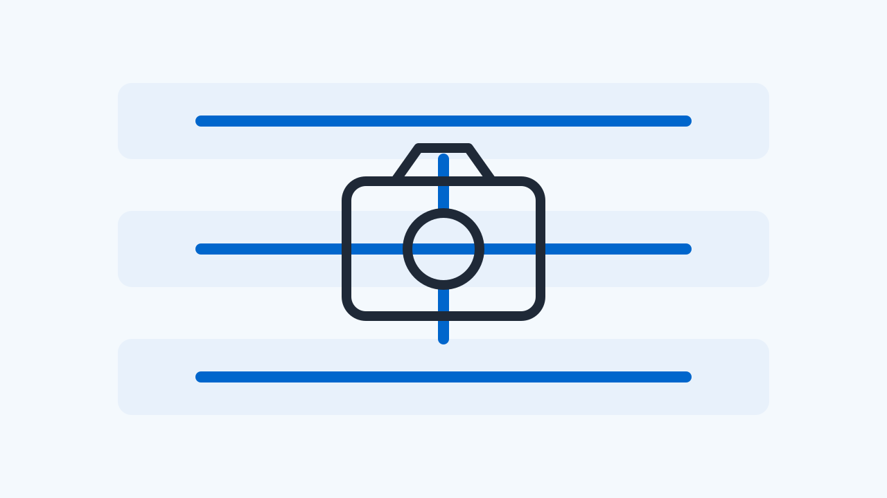

# 2026 W45 (11.02 ~ 11.08)

## 1. This week’s highlights

This week's newsletter brings news on CameraX stability and feature expansion. First, CameraX's timeout mechanism has been strengthened to prevent 3A session deadlocks caused by dropped frames, improving stability. Additionally, the CameraPipe multi-resolution ImageReader bridge has been refactored to support Android 37 API, and LowLightBoostEffect has been introduced to extend CameraX's low-light processing capabilities, allowing app-level image quality correction in low-light environments.

- [CameraX timeout mechanism strengthened to prevent 3A session deadlocks from dropped frames](#article-camerax-timeout-mechanism-strengthened-to-prevent-3a-session-deadlocks-from-drop)

  Defensive logic has been implemented at the framework level to safely release session locks with a 500ms buffer timeout, even if the underlying HAL and sensor drivers delay or drop 3A convergence results.

- [CameraPipe multi-resolution ImageReader bridge refactored for Android 37 API](#article-camerapipe-multi-resolution-imagereader-bridge-refactored-for-android-37-api)

  In an Android 37 environment, MultiResolutionImageReader's concurrent reader support and active Surface callbacks are directly linked to the official framework API, so it is necessary to check the buffer processing flow when configuring related streams.

- [CameraX low-light processing effects expanded with LowLightBoostEffect](#article-camerax-low-light-processing-effects-expanded-with-lowlightboosteffect)

  This is an extension of CameraX's post-processing effect pipeline, but it does not involve direct interface contract changes at the HAL level; it can be understood as a change in the higher-level frame processing path.

## 2. CameraX timeout mechanism strengthened to prevent 3A session deadlocks from dropped frames

_AndroidX Gerrit Camera (Change 4365755)_

CameraX 3A wait control now uses an absolute time-based safety timeout to prevent higher-level sessions from freezing indefinitely, even if the underlying camera HAL stops transmitting frames.

### Camera HAL/Driver perspective: what it means

Defensive logic has been implemented at the framework level to safely release session locks with a 500ms buffer timeout, even if the underlying HAL and sensor drivers delay or drop 3A convergence results.

A change to enhance CameraX's CapturePipeline and 3A control logic was merged into the AndroidX main branch on November 3, 2026. Previously, CameraPipe's 3A state listener evaluated timeouts based on the interval between sensor timestamps of repeating frames. This created a vulnerability where asynchronous operations could wait indefinitely, holding a session lock, if frame transmission stopped in the underlying HAL or driver pipeline while the camera device was open.

This patch introduced withTimeoutOrNull, an absolute time-based timeout, across all waiting paths for lock3AForCapture, lockAf, unlockAf, startFocusAndMeteringAsync, and cancelFocusAndMeteringAsync. The timeout duration is the existing nanosecond limit plus a 500-millisecond buffer. Additionally, to prevent leaks that occurred in the CapturePipeline's result waiting coroutine, the code was refactored into a finally block structure that ensures listeners are cleaned up and completion signals are closed upon exception or termination.

The patch also modified the system to immediately propagate session closed errors by capturing the onRequestSequenceAborted event, which is called when a capture sequence is canceled due to a camera session interruption. This reduces the risk of framework deadlocks where the session might halt without recovery at higher layers if a driver fault or hardware delay occurs.

This change improves the robustness of the framework layer and does not directly fix 3A algorithm bugs in the camera HAL or kernel driver itself. To monitor whether sessions are properly reclaimed when 3A results are delayed, regression checks that artificially trigger a repeating request abort sequence can be proposed. The confirmed scope is currently the merged state in the androidx-main source tree; actual binary distribution and application to device product builds require separate verification of release schedules.

[Back to this week’s highlights](#issue-briefing)

**Sources**

- [Fix CapturePipeline and 3A indefinite waits - platform/frameworks/support](https://android-review.googlesource.com/c/platform/frameworks/support/+/4365755)

---

## 3. CameraPipe multi-resolution ImageReader bridge refactored for Android 37 API

_AndroidX Gerrit Camera (Change 4423978)_

CameraPipe, CameraX's internal implementation, has transitioned its multi-resolution reader and active Surface detection features to the official Android 37 API, aligning with the compileSdk 37 upgrade.

### Camera HAL/Driver perspective: what it means

In an Android 37 environment, MultiResolutionImageReader's concurrent reader support and active Surface callbacks are directly linked to the official framework API, so it is necessary to check the buffer processing flow when configuring related streams.

A commit to replace CameraPipe's internal compatibility layer with the official Android 37 API was merged into the platform/frameworks/support branch on November 7, 2026. As the project's compileSdk was upgraded to 37, the system now directly calls platform framework functions via the Api37Compat class instead of the temporary abstraction PlatformApiCompat.

The main changes are in the control of MultiResolutionImageReader. Api37Compat now includes isConcurrentReadersSupported, buildMultiResolutionImageReader, and setOnActiveOutputSurfacesListener. Consequently, Camera2MultiResolutionStreamConfigurationMap directly queries the framework for concurrent reader support on API level 37 and above, and explicitly returns false for versions below that.

Additionally, validation logic was refined for AndroidMultiResolutionImageReader creation to bind Api37Compat's active Surface listener only in environments where concurrent output is enabled. When the reader receives a list of active Surfaces, it maps the expected output identifiers and passes them to the higher-level pipeline, clarifying buffer pipeline processing during resolution switching on devices with multiple physical cameras.

This commit refactored CameraPipe's internal platform bridging code and does not mandate new camera HAL interface bindings or immediate driver modifications. For devices targeting an API 37 environment, it is useful to observe whether frame drops or format mismatches occur when applying MultiResolutionImageReader stream configurations and concurrent output flags. This patch is currently reflected in the androidx-main source tree, and its product release timing is separate.

[Back to this week’s highlights](#issue-briefing)

**Sources**

- [Transition PlatformApiCompat usages in CameraPipe to Api37Compat - platform/frameworks/support](https://android-review.googlesource.com/c/platform/frameworks/support/+/4423978)

---

## 4. CameraX low-light processing effects expanded with LowLightBoostEffect

_AndroidX Gerrit Camera (Change 4223279)_

LowLightBoostEffect, an extension of CameraEffect that allows app-level image quality correction in low-light environments, has been merged into the CameraX main tree.

### Camera HAL/Driver perspective: what it means

This is an extension of CameraX's post-processing effect pipeline, but it does not involve direct interface contract changes at the HAL level; it can be understood as a change in the higher-level frame processing path.

A major patch introducing LowLightBoostEffect and its associated session manager was merged into the AndroidX main branch on November 3, 2026. This change added over 2,900 lines of code across 8 source files, integrating a new effect into the CameraX effects ecosystem.

The newly added LowLightBoostEffect inherits from the existing CameraEffect abstract class. Application developers can create an instance through a constructor that takes a context and a target, and control the effect using LiveData-based state observation and the setLowLightBoostEnabled method. Additionally, isSupportedAsync and isSupported methods are exposed to asynchronously and synchronously determine effect support based on device and camera information.

This feature operates by post-processing camera frames through a framework-level Surface Processor and session manager. It does not directly change the camera HAL's interface specifications or require new driver control code. However, frame delays or memory bandwidth consumption may occur during effect processing, so changes in the higher-level image processing pipeline should be noted.

The scope confirmed in the original source is that the source code has been merged into the androidx-main tree. Specific post-processing algorithm specifications or commercial release artifact distribution schedules are not yet confirmed, so subsequent release notes should be monitored.

[Back to this week’s highlights](#issue-briefing)

**Sources**

- [Add LowLightBoostEffect, surface processor and session manager - platform/frameworks/support](https://android-review.googlesource.com/c/platform/frameworks/support/+/4223279)

## References

- [Fix CapturePipeline and 3A indefinite waits - platform/frameworks/support](https://android-review.googlesource.com/c/platform/frameworks/support/+/4365755)
- [Transition PlatformApiCompat usages in CameraPipe to Api37Compat - platform/frameworks/support](https://android-review.googlesource.com/c/platform/frameworks/support/+/4423978)
- [Add LowLightBoostEffect, surface processor and session manager - platform/frameworks/support](https://android-review.googlesource.com/c/platform/frameworks/support/+/4223279)
