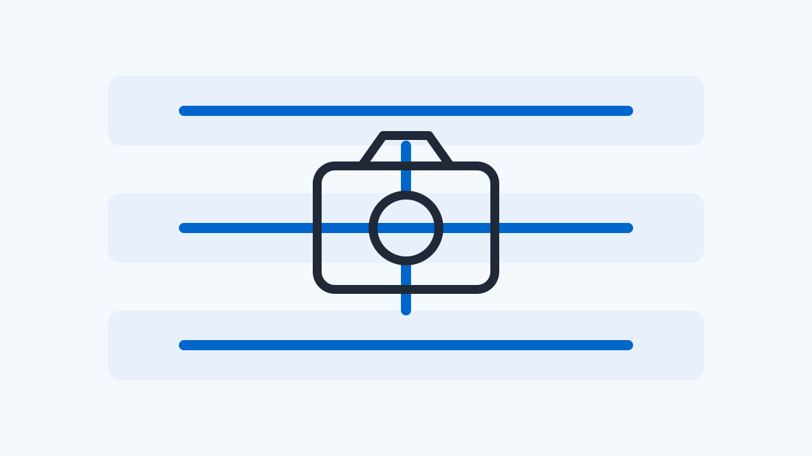

# 2026 W47 (11.16 ~ 11.22)

## 1. This week’s highlights

CameraX 1.7.0 lets apps select a physical camera directly. On the OPPO Find N3 Flip, CameraX hides two physical IDs that could stall the camera service when targeted. We look at a stalled zoom switch on the SM-F971 and a CameraPipe change that rejects unsupported 3A requests immediately. Logging the first video frame’s PTS separately from its output callback helps distinguish a queued frame from delayed delivery.

- [CameraX 1.7.0 lets apps bind to a specific physical camera](#article-camerax-1-7-0-lets-apps-bind-to-a-specific-physical-camera)

  Record the advertised lens IDs and the binding result together to locate the failure.

- [When a 3A request fails immediately, check the camera ID](#article-when-a-3a-request-fails-immediately-check-the-camera-id)

  An unsupported request and an accepted request that is slow to converge leave different traces.

- [Why the second lens switch stalled on the Samsung SM-F971](#article-why-the-second-lens-switch-stalled-on-the-samsung-sm-f971)

  Compare the first capture result after the same lens switch with ZSL enabled and disabled.

- [Why CameraX hides two physical cameras on the OPPO Find N3 Flip](#article-why-camerax-hides-two-physical-cameras-on-the-oppo-find-n3-flip)

  Match the app’s disconnect with the configured physical ID and the last HAL flush record.

- [When does the first video frame arrive? CameraX changes when encoder input opens](#article-when-does-the-first-video-frame-arrive-camerax-changes-when-encoder-input-opens)

  Log the first output’s PTS separately from its callback arrival time to distinguish a queued frame from delayed delivery.

## 2. CameraX 1.7.0 lets apps bind to a specific physical camera

_Android Developers Latest Updates_

Was the lens missing from the list, or did it fail to open after the app selected it? CameraX 1.7.0 gives developers a way to tell.

### Camera HAL/Driver perspective: what it means

Record the advertised lens IDs and the binding result together to locate the failure.

_Image: [CameraX Release Notes - CameraX 1.7.0](https://developer.android.com/jetpack/androidx/releases/camera#1.7.0)_

Released on November 18, CameraX 1.7.0 lets an app obtain a CameraSelector from the physical camera information returned by CameraInfo.getPhysicalCameraInfos(). The app can use that selector to bind capture use cases to a particular camera.

Camera2Interop V2 is now stable and needs no opt-in. When building a focus and metering request, apps can also use FocusMeteringAction.Builder.setLockingMode() to request exposure and white-balance locks.

When migrating a lens picker, log the physical IDs the device returned alongside the ID the app requested for binding. Those two records distinguish a lens that was never offered from one that was selected but failed when capture began.

[Back to this week’s highlights](#issue-briefing)

**Sources**

- [CameraX Release Notes - CameraX 1.7.0](https://developer.android.com/jetpack/androidx/releases/camera#1.7.0)

---

## 3. When a 3A request fails immediately, check the camera ID

_AndroidX Gerrit Camera_

CameraPipe now checks which modes a camera advertises before waiting for focus or exposure to change.

### Camera HAL/Driver perspective: what it means

An unsupported request and an accepted request that is slow to converge leave different traces.

A change merged on November 19 makes Controller3A check the requested exposure (AE), focus (AF), white-balance (AWB), control and flash modes against that camera’s CameraMetadata. The check runs when updating, submitting or locking 3A.

If a requested mode is absent, CameraPipe logs a warning and returns SUBMIT_FAILED immediately. The previous 3A state is preserved. The change record does not identify a released CameraX artifact or device build containing the fix.

On a build containing the patch, compare the camera ID and mode in the warning with the values the app requested. If the request was accepted but the lock was slow, follow the 3A states in subsequent capture results.

[Back to this week’s highlights](#issue-briefing)

**Sources**

- [Check if 3A modes are supported in Controller3A - platform/frameworks/support](https://android-review.googlesource.com/c/platform/frameworks/support/+/4439488)

---

## 4. Why the second lens switch stalled on the Samsung SM-F971

_AndroidX Gerrit Camera_

The same zoom sequence on the same phone completed in a regular session. With ZSL enabled, the last switch stalled.

### Camera HAL/Driver perspective: what it means

Compare the first capture result after the same lens switch with ZSL enabled and disabled.

The report describes a Samsung SM-F971U1 using PRIVATE reprocessing for zero shutter lag (ZSL). After zoom changed from 2.0× to 0.6× and back to 2.0×, no TotalCaptureResult arrived for the new repeating request. The setZoomRatio() call then timed out.

In a regular capture session, both the zoom transitions and still capture completed. A patch merged on November 17 disables ZSL for models with the SM-F971 prefix and uses regular still capture instead. The change record does not establish which CameraX release or shipping device build includes this workaround.

When investigating a similar timeout, keep the lens-switch sequence fixed and vary only ZSL. Match each zoom request with its first subsequent capture result to see which transition stopped producing results.

[Back to this week’s highlights](#issue-briefing)

**Sources**

- [Disable ZSL on Samsung SM-F971 - platform/frameworks/support](https://android-review.googlesource.com/c/platform/frameworks/support/+/4441195)

---

## 5. Why CameraX hides two physical cameras on the OPPO Find N3 Flip

_AndroidX Gerrit Camera_

On the PHT110, physical IDs 2 and 3 appeared in the list. Targeting either one could bring down the camera service.

### Camera HAL/Driver perspective: what it means

Match the app’s disconnect with the configured physical ID and the last HAL flush record.

When an output targeted physical ID 2 or 3 on rear logical camera 0, capture stalled in the vendor HAL’s P2StreamingNode. The session’s BasicSession::flush call then failed to return.

After the watchdog terminated the camera services, the app saw ERROR_CAMERA_DEVICE and CAMERA_DISCONNECTED. A CameraX patch merged on November 17 removes both IDs from the results of getPhysicalCameraInfos() on the PHT110. The change is merged into androidx-main. Inclusion in a CameraX release or a product build still needs verification.

For an existing incident, work back from the disconnect. Match the physical ID in the output configuration with the capture stall and the last flush record. On a patched build, first check whether the two IDs have disappeared from the lens list.

[Back to this week’s highlights](#issue-briefing)

**Sources**

- [Exclude OPPO PHT110 physical camera IDs 2 and 3 - platform/frameworks/support](https://android-review.googlesource.com/c/platform/frameworks/support/+/4440995)

---

## 6. When does the first video frame arrive? CameraX changes when encoder input opens

_AndroidX Gerrit Camera_

The camera can deliver frames before recording starts. A CameraX patch merged on November 20 changes what the video encoder does with those early frames.

### Camera HAL/Driver perspective: what it means

Log the first output’s PTS separately from its callback arrival time to distinguish a queued frame from delayed delivery.

### What the patch changes

EncoderImpl configures MediaCodec and attaches its persistent input surface ahead of recording. It does so again after a stop to prepare for the next recording. Previously, GraphicBufferSource held frames received while the codec was CONFIGURED. It could submit them inside MediaCodec.start() before the output buffer pools had finished initializing.

On API 29 and later, the patched encoder sets KEY_CREATE_INPUT_SURFACE_SUSPENDED at configuration. It drops frames received in that state and resumes input via PARAMETER_KEY_SUSPEND immediately after MediaCodec.start() returns. The added test feeds frames before start and checks that the first encoded output has a presentation timestamp (PTS) at or after a recorded cutoff and is a keyframe. The patch reports no measured reduction in startup latency. The change is merged into androidx-main. The record identifies no CameraX release or device build that includes it.

### What to trace on a device

Trace the first recording and a restart immediately after stopping as separate runs. Record camera frame arrival, entry to and return from codec start, and the first output callback. Record the first output’s PTS and keyframe flag as well. PTS identifies the frame’s place on the media timeline. The callback time tells you when the app received it. Match clock domains and units before comparing camera and encoder timestamps.

If the first output carries an old PTS from before recording began, investigate whether a frame queued during configuration survived into the output. If the PTS is in the expected range but the callback arrives late, measure time inside codec start separately from the interval between its return and output delivery. The device trace determines which explanation fits.

[Back to this week’s highlights](#issue-briefing)

**Sources**

- [Suspend video encoder input surface until start - platform/frameworks/support](https://android-review.googlesource.com/c/platform/frameworks/support/+/4400407)

## Further reading

- [Honor abort cancellation in still capture control - platform/frameworks/support](<https://android-review.googlesource.com/c/platform/frameworks/support/+/4449679>) — AndroidX Gerrit Camera (2026-11-19) · AOSP Camera framework reference
- [Extend Samsung Extensions close quirk to API 35+ - platform/frameworks/support](<https://android-review.googlesource.com/c/platform/frameworks/support/+/4441276>) — AndroidX Gerrit Camera (2026-11-18) · AOSP Camera framework reference
- [Use HLG10 camera stream for Dolby Vision on Xiaomi 17 Pro Max - platform/frameworks/support](<https://android-review.googlesource.com/c/platform/frameworks/support/+/4445746>) — AndroidX Gerrit Camera (2026-11-17) · AOSP Camera framework reference
- [Claude Code v2.1.327](<https://github.com/anthropics/claude-code/releases/tag/v2.1.327>) — Claude Code Changelog (2026-11-17) · C++ and AI native tooling reference

## References

- [CameraX Release Notes - CameraX 1.7.0](https://developer.android.com/jetpack/androidx/releases/camera#1.7.0)
- [Check if 3A modes are supported in Controller3A - platform/frameworks/support](https://android-review.googlesource.com/c/platform/frameworks/support/+/4439488)
- [Disable ZSL on Samsung SM-F971 - platform/frameworks/support](https://android-review.googlesource.com/c/platform/frameworks/support/+/4441195)
- [Exclude OPPO PHT110 physical camera IDs 2 and 3 - platform/frameworks/support](https://android-review.googlesource.com/c/platform/frameworks/support/+/4440995)
- [Suspend video encoder input surface until start - platform/frameworks/support](https://android-review.googlesource.com/c/platform/frameworks/support/+/4400407)
