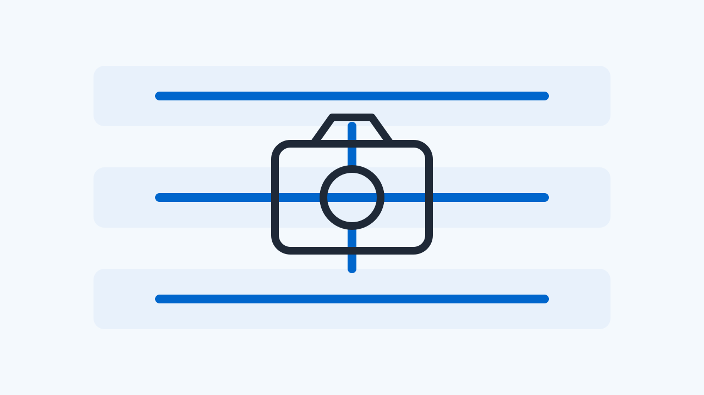

# 2026 W43 (10.19 ~ 10.25)

## 1. 이번 주 핵심

이번 주 뉴스레터에서는 CameraX 관련 여러 개선 사항을 다룹니다. "CameraX SessionConfigAdapter"는 표면 교체 시 잘못된 세션 리셋을 유발하던 경쟁 조건을 수정했고, "CameraX ZslControl"은 플래시 전환 및 요청 취소 시 발생하는 그래픽 메모리 누수를 해결했습니다. 또한 "CameraX UseCaseCameraState"는 일시적 프레임 드롭 시 상태 업데이트 신호가 조기 실패하던 오류를 보완했으며, "CameraX VideoCapture"는 비디오 인코더 조기 해제 시 발생하는 네이티브 스레드 누수를 수정했습니다. 이와 함께 "Qualcomm SM8450 플랫폼"의 업스트림 CAMSS 드라이버 및 독립 CSI2 PHY 지원 패치 제안 소식도 전해드립니다.

- [CameraX SessionConfigAdapter, 표면 교체 시 잘못된 세션 리셋을 유발하던 경쟁 조건 수정](#article-camerax-sessionconfigadapter)

  하위 Camera HAL 인터페이스 자체의 규격 변화는 없으나, 상위 프레임워크가 잘못된 에러 콜백으로 configureStreams와 요청 루프를 불필요하게 재시작하던 상위 레이스 컨디션을 줄여줍니다.

- [CameraX ZslControl, 플래시 전환 및 요청 취소 시 발생하는 그래픽 메모리 누수 수정](#article-camerax-zslcontrol)

  하위 그래픽 메모리 할당 계층에서 버퍼가 고정되어 발생할 수 있는 메모리 압박 및 out-of-memory 킬을 방지하는 상위 버퍼 반환 경로 수정입니다.

- [CameraX UseCaseCameraState, 일시적 프레임 드롭 시 상태 업데이트 신호가 조기 실패하던 오류 수정](#article-camerax-usecasecamerastate)

  드라이버나 ISP 단에서 발생하는 일시적 프레임 드롭이 상위 프레임워크의 파이프라인 전체 오류로 확산되지 않도록 완충해 줍니다.

- [CameraX VideoCapture, 비디오 인코더 조기 해제 시 발생하는 네이티브 스레드 누수 수정](#article-camerax-videocapture)

  Camera HAL 계약의 직접적인 변경은 아니지만, 카메라 프레임이 전달되는 다운스트림 비디오 인코더 계층의 스레드 자원 누수를 막아 앱의 장기 안정성을 개선합니다.

- [Qualcomm SM8450 플랫폼, 업스트림 CAMSS 드라이버 및 독립 CSI2 PHY 지원 패치 제안](#article-qualcomm-sm8450-camss-csi2-phy)

  커널 레벨의 V4L2 장치 노드 및 CSI2 수신 파이프라인이 정립되는 초기 단계이므로, 향후 AOSP CameraProvider 포팅 시 하위 미디어 토폴로지 참고 자료로 유용합니다.

## 2. CameraX SessionConfigAdapter, 표면 교체 시 잘못된 세션 리셋을 유발하던 경쟁 조건 수정

_AndroidX Gerrit Camera (Change 4372671)_

카메라 미리보기 도중 화면 회전이나 화면 전환으로 표면을 교체할 때 드물게 세션 리셋 에러가 발생하던 타이밍 오류가 해결되었습니다.

### Camera HAL/Driver 관점에서의 의미

하위 Camera HAL 인터페이스 자체의 규격 변화는 없으나, 상위 프레임워크가 잘못된 에러 콜백으로 configureStreams와 요청 루프를 불필요하게 재시작하던 상위 레이스 컨디션을 줄여줍니다.

카메라 앱이 프리뷰 표면 공급자를 교체하는 시점에 하위 스트림 표면이 닫히면 예기치 않은 재구성 에러가 발생하는 현상이 있었습니다.

기존 동작에서는 백그라운드 코루틴에서 SurfaceClosedException을 감지했을 때 세션 구성 정보를 동기화 없이 두 차례 연달아 읽도록 되어 있었습니다. 첫 번째 읽기에서 기존 구성을 찾더라도, 메인 스레드가 거의 동시에 새로운 세션 구성으로 교체하면 두 번째 읽기에서 방금 연결된 활성 구성이 참조되었습니다. 이로 인해 정상적으로 연결된 새 구성에 불필요한 SESSION_ERROR_SURFACE_NEEDS_RESET 에러가 전달되어 세션 파이프라인이 엉키는 문제가 발생했습니다.

이번 커밋 패치는 메인 스레드 디스패처 상에서 단 한 번의 호출로 대상 구성을 조회하도록 변경했습니다. 또한 기존에 누락되었던 보조 세션 구성 및 포스트뷰 표면 일치 여부까지 함께 검사하도록 보완했습니다.

점검이 필요한 환경에서는 프리뷰 표면을 반복적으로 갱신하면서 세션 재구성이 진행될 때 활성 파이프라인에 리셋 에러 콜백이 유입되는지 관찰하는 방법을 검토할 수 있습니다. 다만 본 확인은 소스 트리 병합 단계이며, 배포 라이브러리 및 최종 제품 빌드 반영 여부는 별도로 확인해야 합니다.

[이번 주 핵심으로](#issue-briefing)

**출처**

- [Fix SessionConfigAdapter.reportSurfaceInvalid race - platform/frameworks/support](https://android-review.googlesource.com/c/platform/frameworks/support/+/4372671)

---

## 3. CameraX ZslControl, 플래시 전환 및 요청 취소 시 발생하는 그래픽 메모리 누수 수정

_AndroidX Gerrit Camera (Change 4365734)_

셔터 지연 없는 촬영(ZSL) 기능이 켜져 있을 때 플래시를 사용하거나 촬영을 취소할 경우 수십 메가바이트의 그래픽 버퍼가 반환되지 않던 메모리 누수가 해결되었습니다.

### Camera HAL/Driver 관점에서의 의미

하위 그래픽 메모리 할당 계층에서 버퍼가 고정되어 발생할 수 있는 메모리 압박 및 out-of-memory 킬을 방지하는 상위 버퍼 반환 경로 수정입니다.

제로 셔터 랙 기능은 셔터를 누르기 전의 프레임을 링 버퍼에 미리 보관하므로 버퍼 수명 주기 관리가 매우 중요합니다.

기존 구현에서는 플래시 촬영이 활성화되어 ZSL이 비활성화되더라도 링 버퍼에 이미 들어 있던 프레임들이 비워지지 않았습니다. 이로 인해 3개에서 6개에 달하는 전체 해상도 PRIV 또는 YUV 그래픽 하드웨어 버퍼(약 54MB에서 108MB)가 해제되지 않고 메모리에 고정되는 문제가 있었습니다. 또한 캡처 요청 매핑 과정에서 결과 객체 변환에 실패하거나 요청 시퀀스가 중단되었을 때, 큐에서 꺼낸 ImageProxy 객체가 닫히지 않고 유실되는 누수 경로도 존재했습니다.

이번 패치에서는 플래시 모드 설정이나 유스케이스 해제 시 ZslRingBuffer 내부 버퍼를 명시적으로 드레인하도록 개선했습니다. 아울러 캡처 요청 변환 실패나 onRequestSequenceAborted 콜백 유입 시 예외 블록을 통해 꺼내온 이미지 프록시가 반드시 close되도록 보장했습니다.

실무 환경에서는 ZSL이 활성화된 상태에서 플래시 모드를 켜고 끄거나 고해상도 연속 캡처 도중 세션을 재시작하면서 GraphicBuffer 할당량 추이를 프로파일링하여 개선 효과를 점검할 수 있습니다. 이는 패치 소스 분석에 기반한 확인 방안이며 최종 배포 바이너리 포함 여부는 확인이 필요합니다.

[이번 주 핵심으로](#issue-briefing)

**출처**

- [Fix ZslControl ring buffer and ImageProxy leaks - platform/frameworks/support](https://android-review.googlesource.com/c/platform/frameworks/support/+/4365734)

---

## 4. CameraX UseCaseCameraState, 일시적 프레임 드롭 시 상태 업데이트 신호가 조기 실패하던 오류 수정

_AndroidX Gerrit Camera (Change 4381410)_

카메라 반복 촬영 도중 순간적으로 프레임 드롭이 발생해도 유스케이스 설정이나 초점 제어 작업이 비정상 종료되지 않도록 보완되었습니다.

### Camera HAL/Driver 관점에서의 의미

드라이버나 ISP 단에서 발생하는 일시적 프레임 드롭이 상위 프레임워크의 파이프라인 전체 오류로 확산되지 않도록 완충해 줍니다.

미리보기처럼 연속적으로 스트림을 요청하는 환경에서는 센서나 버퍼 타이밍에 따라 단일 프레임 드롭이 발생할 수 있습니다.

이전 구조에서는 하위 Camera2 프레임워크로부터 CaptureCallback.onCaptureFailed 콜백이 유입되면, 이것이 일시적인 프레임 누락에 불과하더라도 UseCaseCameraState가 모든 대기 중인 상태 업데이트 신호를 즉각 에러로 완료시켰습니다. 그 결과 유스케이스 활성화 제어나 3A 제어 로직이 정상적인 표면 전환 과정에서 불필요하게 예외를 일으키며 실패하는 결함이 있었습니다.

수정된 로직은 단일 프레임 실패 시 신호를 즉시 취소하지 않고 대기열에 유지합니다. 동일하거나 더 큰 요청 번호를 가진 다음 프레임이 onTotalCaptureResult로 정상 반환되거나, 반복 요청이 완전히 정지될 때까지 신호 완료를 미룹니다. 또한 락 경합을 피하기 위해 신호의 인큐 및 드레인 작업을 락 내부에서 안전하게 분리했습니다.

점검 환경에서는 높은 부하 상태에서 센서 모드를 변경하거나 표면을 갱신할 때 단일 프레임 드롭 로그 발생 직후 3A 또는 유스케이스 전환 Future가 조기에 중단되는지 관찰하는 시나리오를 구성할 수 있습니다. 이는 병합된 소스 코드에 근거한 확인 방안이며 최종 라이브러리 릴리스 및 제품 반영 여부는 별도로 확인해야 합니다.

[이번 주 핵심으로](#issue-briefing)

**출처**

- [Keep UseCaseCameraState signals pending on repeating frame failure - platform/frameworks/support](https://android-review.googlesource.com/c/platform/frameworks/support/+/4381410)

---

## 5. CameraX VideoCapture, 비디오 인코더 조기 해제 시 발생하는 네이티브 스레드 누수 수정

_AndroidX Gerrit Camera (Change 4375770)_

비디오 촬영 유스케이스를 화면에서 바인드했다가 녹화 없이 해제할 때마다 미디어 프레임워크 스레드가 시스템에 계속 남던 누수 문제가 해결되었습니다.

### Camera HAL/Driver 관점에서의 의미

Camera HAL 계약의 직접적인 변경은 아니지만, 카메라 프레임이 전달되는 다운스트림 비디오 인코더 계층의 스레드 자원 누수를 막아 앱의 장기 안정성을 개선합니다.

비디오 캡처 유스케이스는 빠른 녹화 시작을 위해 인코더를 미리 구성하지만, 녹화 버튼을 누르지 않고 화면을 닫으면 인코더가 한 번도 시작되지 않은 상태로 해제됩니다.

Android 10(API 29)에서 도입된 Codec2 프레임워크에서는 표면 입력을 갖도록 구성된 미디어 코덱을 시작하지 않고 곧바로 release할 경우, C2NodeImpl 네이티브 스레드가 프로세스가 종료될 때까지 남아 있는 결함이 있었습니다. 이로 인해 앱에서 비디오 캡처 화면을 드나들 때마다 프로세스 내 네이티브 스레드가 계속해서 쌓이는 현상이 발생했습니다.

이번 패치에서는 VideoEncoderLeaksThreadOnReleaseWithoutStartQuirk를 추가하여, 인코더가 구성된 후 시작되지 않은 상태라면 release 직전에 코덱을 의도적으로 start하도록 처리했습니다. 코덱을 시작함으로써 미디어 프레임워크가 입력 표면 연결을 정상적으로 정리하고 네이티브 스레드를 종료할 수 있게 유도하는 방식입니다. 이 추가 시작 과정은 인코더 백그라운드 스레드에서 수행되며 해제 시점에 약 9밀리초에서 24밀리초 정도의 추가 지연이 발생할 수 있습니다.

점검 환경에서는 비디오 캡처 유스케이스를 반복해서 바인드 및 언바인드한 후 /proc/self/task 경로를 확인하여 C2NodeImpl 또는 C2OMXNode 스레드 수가 증가하는지 여부를 검증할 수 있습니다. 이 확인은 소스 트리 병합에 기반한 제안이며 정식 라이브러리 배포본 포함 여부는 추가 조사가 필요합니다.

[이번 주 핵심으로](#issue-briefing)

**출처**

- [Fix native thread leak when releasing an unstarted video encoder - platform/frameworks/support](https://android-review.googlesource.com/c/platform/frameworks/support/+/4375770)

---

## 6. Qualcomm SM8450 플랫폼, 업스트림 CAMSS 드라이버 및 독립 CSI2 PHY 지원 패치 제안

_lore.kernel.org linux-media list_

퀄컴 SM8450 플랫폼의 카메라 서브시스템을 업스트림 리눅스 커널에서 지원하기 위한 드라이버 추가 및 독립 CSI2 PHY 구성 패치 시리즈가 제안되었습니다.

### Camera HAL/Driver 관점에서의 의미

커널 레벨의 V4L2 장치 노드 및 CSI2 수신 파이프라인이 정립되는 초기 단계이므로, 향후 AOSP CameraProvider 포팅 시 하위 미디어 토폴로지 참고 자료로 유용합니다.

모바일 및 임베디드 기기에서 퀄컴 하드웨어를 오픈소스 리눅스 커널로 구동할 때 카메라 수신 파이프라인 지원은 필수적인 선결 과제입니다.

이번에 제출된 7편의 패치 시리즈는 Qualcomm SM8450(Waipio) SoC의 CAMSS 드라이버 지원을 추가합니다. 물리 계층인 CSIPHY는 기존 레거시 리소스 구조 대신 X1E80100 플랫폼과 호환되는 독립적인 장치로 분리하여 디바이스 트리에 정의되었습니다. 제출자에 따르면 해당 CSIPHY IP는 Hamoa 플랫폼에 적용된 구조와 동일하며, 비공개 테스트 보드 환경에서 테스트 패턴 생성기(TPG)로부터 CSID로 이어지는 이미지 스트리밍 동작 검증을 거쳤습니다.

다만 이번 내용은 2026년 10월 23일 linux-next-20261023 트리를 기반으로 메일링 리스트에 제출된 패치 제안이며, 이후의 메인라인 커널 병합 여부나 실제 릴리스 반영 이력은 원문에서 확인되지 않았습니다. 또한 본 변경은 리눅스 V4L2 및 미디어 컨트롤러 수준의 커널 드라이버 구성이므로 안드로이드 Camera HAL 인터페이스 계약 자체를 직접 변경하지는 않습니다.

향후 SM8450 기반 AOSP 보드 포팅이나 메인라인 커널 빌드를 계획 중인 엔지니어라면 sm8450.dtsi의 CAMSS 디바이스 트리 노드 구성 및 MCLK 핀 디스크립션 규격을 미리 검토해 둘 수 있습니다.

[이번 주 핵심으로](#issue-briefing)

**출처**

- [[PATCH 0/7] media: qcom: camss: Add Waipio CAMSS support](https://lore.kernel.org/linux-media/20261023163057.775917-1-vz@kernel.org/) — [전체 패치 시리즈](https://lore.kernel.org/linux-media/20261023163057.775917-1-vz@kernel.org/T/#t)

## 참고자료

- [Fix SessionConfigAdapter.reportSurfaceInvalid race - platform/frameworks/support](https://android-review.googlesource.com/c/platform/frameworks/support/+/4372671)
- [Fix ZslControl ring buffer and ImageProxy leaks - platform/frameworks/support](https://android-review.googlesource.com/c/platform/frameworks/support/+/4365734)
- [Keep UseCaseCameraState signals pending on repeating frame failure - platform/frameworks/support](https://android-review.googlesource.com/c/platform/frameworks/support/+/4381410)
- [Fix native thread leak when releasing an unstarted video encoder - platform/frameworks/support](https://android-review.googlesource.com/c/platform/frameworks/support/+/4375770)
- [[PATCH 0/7] media: qcom: camss: Add Waipio CAMSS support](https://lore.kernel.org/linux-media/20261023163057.775917-1-vz@kernel.org/) — [전체 패치 시리즈](https://lore.kernel.org/linux-media/20261023163057.775917-1-vz@kernel.org/T/#t)
