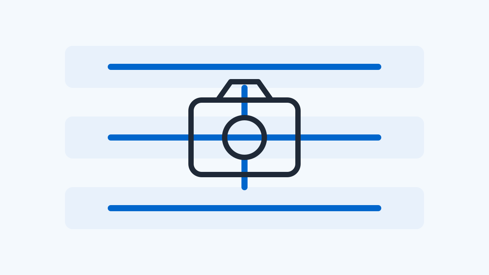
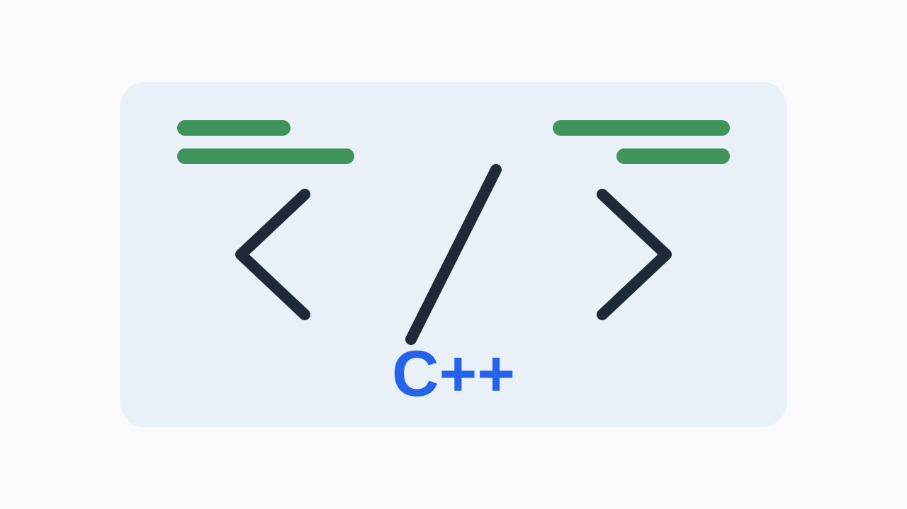

# 2026 W45 (11.02 ~ 11.08)

## 1. 이번 주 핵심

이번 주 뉴스레터에서는 카메라 시스템의 안정성과 성능 향상을 위한 다양한 업데이트를 다룹니다. CameraX 1.7.0-rc02는 API 30 바인딩 크래시 및 비디오 녹화 스레드 누수를 차단하여 프레임워크 안정성을 강화했습니다. 또한, Tecno BF6 기기 대상 동영상 녹화 중 사진 촬영 HAL 타임아웃 회피 패치와 갤럭시 노트 10+ 스냅드래곤의 전면 줌 촬영 시 HAL 데드락 방지 패치는 특정 기기에서 발생하던 문제를 해결했습니다. 마지막으로, redfin 64비트 전용 랩 환경의 카메라 HAL 네이티브 충돌에 대응한 테스트 분기 추가는 특정 환경에서의 안정성을 높이는 데 기여했습니다.

- [CameraX 1.7.0-rc02 공개, API 30 바인딩 크래시와 비디오 녹화 스레드 누수 차단](#article-camerax-1-7-0-rc02-api-30)

  CameraX 프레임워크 계층의 바인딩 및 스레드 수명 주기 결함 수정입니다. 공급업체 HAL 인터페이스나 메타데이터 계약 변경은 없으나, VideoCapture 반복 해제 시 네이티브 미디어 스레드 누적이 차단되어 장시간 카메라 운용 시 프로세스 스레드 고갈 및 리소스 경쟁 위험을 낮춥니다.

- [Tecno BF6 기기 대상 동영상 녹화 중 사진 촬영 HAL 타임아웃 회피 패치 병합](#article-tecno-bf6-hal)

  공급업체 HAL 드라이버의 레코드 템플릿 처리 결함을 상위 CameraX에서 스트림 셰어링 및 CONTROL_CAPTURE_INTENT_PREVIEW 재정의로 우회하는 프레임워크 쿼크입니다. HAL 개발팀은 복합 스트림 상황에서 TEMPLATE_RECORD와 스틸 캡처 동시 처리 시의 타임아웃 방지 로직을 점검해야 합니다.

- [CameraX 엔지니어링 에이전트에 5-Gate 심층 근본 원인 분석 프로토콜 적용](#article-camerax-5-gate)

  HAL 직접 변경은 아니지만, 상위 프레임워크가 벤더 드라이버 결함을 판정할 때 준수해야 할 엄격한 5-Gate 규칙을 제시합니다. HAL 엔지니어는 드라이버 이슈 리포트 시 합성 테스트 실패와 실제 상용 파이프라인의 분기 영향을 명확히 분리하여 대응해야 합니다.

- [redfin 64비트 전용 랩 환경의 카메라 HAL 네이티브 충돌에 대응한 테스트 분기 추가](#article-redfin-64-hal)

  Qualcomm lito(SM7250) 기반 HAL 바이너리가 64비트 전용 런타임에서 특정 스트림 조합 및 UHD HDR 모드 쿼리 시 네이티브 크래시를 일으키는 현상을 명확히 보여줍니다. SoC 플랫폼 엔지니어는 64비트 마이그레이션 시 카메라 공급업체 라이브러리의 포맷 검증과 심볼 호출 안정성을 점검해야 합니다.

- [갤럭시 노트 10+ 스냅드래곤, 전면 줌 촬영 시 HAL 데드락 방지 패치 병합](#article-10-hal)

  Qualcomm CamX 드라이버 내부 IPE 노드의 출력 동기화 펜스 데드락 현상을 상위 프레임워크가 stopRepeating 및 재시작 시퀀스로 우회한 구현입니다. 퀄컴 플랫폼 HAL 개발자는 고배율 크롭 캡처와 다중 스트림 라이브 스냅샷 처리 시 노드 간 펜스 동기화 로직을 면밀히 점검해야 합니다.

## 2. CameraX 1.7.0-rc02 공개, API 30 바인딩 크래시와 비디오 녹화 스레드 누수 차단

_출처: CameraX Release Notes (2026-11-04)_

화면 오버레이 권한을 쓰는 카메라 앱이나 비디오 녹화 기능을 자주 켜고 끄는 서비스에서 간헐적인 비정상 종료와 메모리 점유 누적이 발생했다면 이번 릴리스를 확인할 필요가 있습니다.

### Camera HAL/Driver 관점에서의 의미

CameraX 프레임워크 계층의 바인딩 및 스레드 수명 주기 결함 수정입니다. 공급업체 HAL 인터페이스나 메타데이터 계약 변경은 없으나, VideoCapture 반복 해제 시 네이티브 미디어 스레드 누적이 차단되어 장시간 카메라 운용 시 프로세스 스레드 고갈 및 리소스 경쟁 위험을 낮춥니다.

_이미지: [CameraX Release Notes](https://developer.android.com/jetpack/androidx/releases/camera#1.7.0-rc02)_

구글이 2026년 11월 4일 CameraX 1.7.0-rc02를 출시했습니다. 이번 릴리스 후보 버전에서는 상위 프레임워크 수명 주기 관리와 관련된 두 가지 핵심 결함이 해결되었습니다.

첫 번째 수정 사항은 안드로이드 11(API 30) 환경에서 시스템 경고 창(SYSTEM_ALERT_WINDOW) 권한을 부여받은 앱이 카메라 사용 사례(UseCase)를 반복해서 바인딩할 때 발생하던 지원되지 않는 연산 예외(UnsupportedOperationException)입니다. 플로팅 뷰나 오버레이 형태로 카메라 미리보기를 재시작하는 서비스에서 프레임워크 바인딩 충돌로 프로세스가 죽는 증상을 완화합니다.

두 번째 수정 사항은 비디오 녹화 컴포넌트인 VideoCapture를 수명 주기에서 언바인딩할 때 미디어 프레임워크 네이티브 스레드가 정리되지 않던 문제입니다. 이전 버전에서는 바인딩이 일어날 때마다 미디어 프레임워크 스레드가 하나씩 남아 프로세스 스레드 수가 점진적으로 누적되는 스레드 누수가 존재했습니다.

이번 변경은 Camera HAL 인터페이스 계약이나 드라이버 파이프라인의 직접적인 프로토콜 수정은 아닙니다. 그러나 반복적인 카메라 세션 바인딩과 비디오 스트림 해제 과정에서 상위 계층의 불필요한 스레드 잔존을 제거함으로써 런타임 안정성과 스케줄러 부하를 줄여줍니다. 실제 서비스 배포 시에는 API 30 기기 환경의 오버레이 반복 바인딩과 VideoCapture 언바인딩 시 스레드 수 추이를 프로파일러로 관찰하는 것이 유용합니다. 다만 1.7.0-rc02는 릴리스 후보 배포 단계이므로 최종 정식 배포나 실제 상용 제품 빌드 반영 여부는 별도로 확인해야 합니다.

[이번 주 핵심으로](#issue-briefing)

**출처**

- [CameraX Release Notes - CameraX 1.7.0-rc02](https://developer.android.com/jetpack/androidx/releases/camera#1.7.0-rc02)

---

## 3. Tecno BF6 기기 대상 동영상 녹화 중 사진 촬영 HAL 타임아웃 회피 패치 병합

_출처: AndroidX Gerrit (2026-11-02)_

동영상 촬영 모드가 켜진 상태에서 사진 캡처 버튼을 누를 때 특정 기기의 카메라가 완전히 멈춰버리는 현상을 방지하기 위한 프레임워크 우회 로직이 추가되었습니다.

### Camera HAL/Driver 관점에서의 의미

공급업체 HAL 드라이버의 레코드 템플릿 처리 결함을 상위 CameraX에서 스트림 셰어링 및 CONTROL_CAPTURE_INTENT_PREVIEW 재정의로 우회하는 프레임워크 쿼크입니다. HAL 개발팀은 복합 스트림 상황에서 TEMPLATE_RECORD와 스틸 캡처 동시 처리 시의 타임아웃 방지 로직을 점검해야 합니다.

구글 안드로이드 오픈소스 프로젝트의 frameworks/support 저장소에 Tecno Mobile BF6 기기를 위한 카메라 쿼크 패치가 2026년 11월 2일 병합되었습니다.

Tecno BF6 기기에서는 VideoCapture 사용 사례가 바인딩된 상태에서 스틸 사진 촬영을 시도할 경우, 카메라 HAL 내부에서 타임아웃이 발생하며 프레임을 제때 반환하지 못하는 결함이 있었습니다. 이 문제를 우회하기 위해 프레임워크는 단일 스트림을 공유하는 StreamSharing을 켜고, 반복 요청의 템플릿 의도를 TEMPLATE_RECORD에서 CONTROL_CAPTURE_INTENT_PREVIEW로 재정의해야 정상적인 캡처 처리가 가능했습니다.

이번 패치에서는 ImageCaptureFailedWhenVideoCaptureIsBoundQuirk 클래스에 Tecno BF6 판별 로직(모델명 tecno mobile bf6, tecno bf6 및 디바이스명 tecno-bf6)을 추가했습니다. 아울러 기존 코드에서 여러 기기 플래그를 개별 열거하던 workaroundBySurfaceProcessing 메서드를 isEnabled 판정으로 위임하도록 정리했습니다.

해당 패치의 유효성을 점검하려면 Tecno BF6 기기 환경에서 VideoCapture와 ImageCapture를 함께 바인딩한 후 스틸 사진 캡처를 시도해 카메라 HAL 타임아웃 발생 여부를 관찰하는 편집 제안 점검을 진행할 수 있습니다. 정상 반영 상태라면 기존에 보고되던 HAL 타임아웃 없이 스트림 공유 및 프리뷰 인텐트 기반 요청이 전달되는지 확인할 수 있습니다. 이는 원문의 쿼크 분기에서 도출한 확인 제안이며, 실제 기기에서의 캡처 성공이나 특정 응답 시간을 보장하는 공인 테스트 결과는 아닙니다.

이번 변경은 Tecno 사의 카메라 HAL 자체 소스코드를 수정한 것이 아니며, CameraX 상위 프레임워크가 문제 동작을 감지하고 요청 템플릿과 스트림 분기를 안전하게 우회하도록 지시하는 패치입니다. 현재 해당 커밋은 androidx-main 브랜치에 병합된 상태까지만 확인되었으며, 실제 상용 라이브러리 배포나 단말기 펌웨어 반영 여부는 별도로 확인해야 합니다.

[이번 주 핵심으로](#issue-briefing)

**출처**

- [Add Tecno BF6 to ImageCaptureFailed quirk - platform/frameworks/support](https://android-review.googlesource.com/c/platform/frameworks/support/+/4399969)

---

## 4. CameraX 엔지니어링 에이전트에 5-Gate 심층 근본 원인 분석 프로토콜 적용

_출처: AndroidX Gerrit (2026-11-06)_

카메라 결함을 분석할 때 단순 테스트 실패 로그만 보고 무분별하게 기기 전체 기능을 차단해버리던 관행을 막기 위한 엄격한 5단계 원인 규명 규칙이 제정되었습니다.

### Camera HAL/Driver 관점에서의 의미

HAL 직접 변경은 아니지만, 상위 프레임워크가 벤더 드라이버 결함을 판정할 때 준수해야 할 엄격한 5-Gate 규칙을 제시합니다. HAL 엔지니어는 드라이버 이슈 리포트 시 합성 테스트 실패와 실제 상용 파이프라인의 분기 영향을 명확히 분리하여 대응해야 합니다.

구글 안드로이드 오픈소스 프로젝트의 frameworks/support 저장소에 CameraX 엔지니어링 및 리뷰 스킬을 고도화하는 5-Gate 심층 근본 원인 프로토콜 패치가 2026년 11월 6일 병합되었습니다.

카메라 서브시스템은 하드웨어와 HAL 드라이버 그리고 프레임워크가 복잡하게 얽혀 있어, 특정 합성 테스트 환경의 실패만 보고 광범위한 기기 쿼크(DeviceQuirk)를 적용해 정상 동작하던 기능까지 꺼버리는 부작용이 종종 발생했습니다. 이를 방지하기 위해 CameraX 팀은 다섯 단계의 필수 감사 게이트를 도입했습니다.

첫 번째 게이트는 상용 API와 합성 테스트의 텔레메트리 분리입니다. 두 번째는 종료 시점의 연쇄 오류와 초기 원인 에러의 시간순 분리이며, 세 번째는 상용 파이프라인 패리티 검사입니다. 네 번째는 단일 기기 결함을 가리기 위해 전체 기기의 테스트 검증 기준을 약화하지 않는 시맨틱스 보존이며, 다섯 번째는 실물 단말기에서의 경험적 가설 검증 의무화입니다. 또한 AGENTS.md 지침을 갱신하여 읽기 전용 분석 작업에서 불필요한 반복 검증을 줄이는 적응형 단일 패스 종료 규칙도 신설했습니다.

이 변경은 Android 카메라 런타임이나 HAL 인터페이스의 C++ 코드를 직접 수정한 것이 아닙니다. CameraX 팀 내부의 AI 에이전트 지침과 엔지니어링 코드 리뷰 프로토콜을 규정한 문서 및 스킬 업데이트입니다. 다만 복잡한 카메라 스택 문제를 디버깅하고 벤더 드라이버 결함을 프레임워크 쿼크로 우회할 때 지켜야 할 체계적인 엔지니어링 가이드라인을 제공합니다.

[이번 주 핵심으로](#issue-briefing)

**출처**

- [Enforce 5-Gate Deep Root-Cause Protocol in CameraX skills - platform/frameworks/support](https://android-review.googlesource.com/c/platform/frameworks/support/+/4411322)

---

## 5. redfin 64비트 전용 랩 환경의 카메라 HAL 네이티브 충돌에 대응한 테스트 분기 추가

_출처: AndroidX Gerrit (2026-11-02)_

구형 칩셋 기반 테스트 기기를 64비트 전용 이미지로 운용할 때 복합 카메라 스트림이나 UHD 프레임레이트 설정에서 발생하는 HAL 레벨 크래시의 원인이 드러났습니다.

### Camera HAL/Driver 관점에서의 의미

Qualcomm lito(SM7250) 기반 HAL 바이너리가 64비트 전용 런타임에서 특정 스트림 조합 및 UHD HDR 모드 쿼리 시 네이티브 크래시를 일으키는 현상을 명확히 보여줍니다. SoC 플랫폼 엔지니어는 64비트 마이그레이션 시 카메라 공급업체 라이브러리의 포맷 검증과 심볼 호출 안정성을 점검해야 합니다.

구글 안드로이드 오픈소스 프로젝트의 frameworks/support 저장소에 redfin(Pixel 5) 64비트 전용 환경의 카메라 HAL 충돌 테스트를 건너뛰는 패치가 2026년 11월 2일 병합되었습니다.

구글 내부 랩에서 redfin 기기를 32비트 라이브러리가 제거된 64비트 전용 빌드로 구동할 때 두 가지 치명적인 공급업체 카메라 HAL 충돌이 관찰되었습니다. 첫 번째는 Preview, VideoCapture, ImageCapture를 동시에 바인딩할 때 발생했습니다. 공급업체 HAL 내부의 live_rectiface_processor 컴포넌트에서 프레임 종횡비가 640x480과 640x360으로 불일치하면서 SIGABRT 비정상 종료가 일어났습니다. 두 번째는 UHD 해상도의 VideoCapture에 명시적 목표 FPS를 설정할 때 발생했으며, 퀄컴 CamX 드라이버 바이너리인 camera.lito.so의 QueryStreamHDRMode 함수에서 SIGSEGV 세그멘테이션 폴트가 발생했습니다.

이 문제를 회피하기 위해 테스트 유틸리티에 assumeNotRedfin64BitOnly 검사를 신설했습니다. 디바이스명이 redfin이고 시스템에서 지원하는 32비트 ABI 목록이 비어 있는 랩 환경에 한해 FrameRateTest 및 ImageCapture 관련 스트레스 테스트 케이스를 실행하지 않고 건너뜁니다.

해당 패치의 유효성을 확인하려면 redfin 64비트 전용 이미지 단말에서 FrameRateTest 및 ImageCaptureLifecycleStatusChangeStressTest, ImageCaptureSwitchCameraStressTest를 직접 실행해보는 편집 제안 점검을 수행할 수 있습니다. 정상 반영 상태라면 기존에 발생하던 SIGABRT나 SIGSEGV 네이티브 크래시로 테스트 프로세스가 죽는 대신 해당 테스트 케이스들이 건너뜀(Skipped)으로 안전하게 통과하는 결과를 관찰할 수 있습니다. 이는 테스트 하네스의 동작을 점검하기 위한 제안이며 상용 환경의 결과는 아닙니다.

이번 조치는 공급업체 드라이버 바이너리의 메모리 버그나 종횡비 계산 오류를 수정한 것이 아니라 프레임워크 CI 테스트 하네스에서 예외 처리를 추가한 것입니다. 일반 사용자에게 판매된 멀티라이브러리 Pixel 5 상용 펌웨어의 동작에는 영향이 없으며, 현재 확인된 범위는 androidx-main 소스 트리의 병합 상태까지입니다. 실제 라이브러리 배포판이나 상용 제품 빌드 반영 여부는 별도로 확인해야 합니다.

[이번 주 핵심으로](#issue-briefing)

**출처**

- [Skip redfin 64-bit-only HAL crash test cases - platform/frameworks/support](https://android-review.googlesource.com/c/platform/frameworks/support/+/4403075)

---

## 6. 갤럭시 노트 10+ 스냅드래곤, 전면 줌 촬영 시 HAL 데드락 방지 패치 병합

_출처: AndroidX Gerrit (2026-11-02)_

전면 카메라로 셀피를 찍을 때 화면을 확대하고 비디오나 분석 스트림이 동시에 돌아가면 카메라 디바이스 에러가 발생하던 현상의 원인이 밝혀졌습니다.

### Camera HAL/Driver 관점에서의 의미

Qualcomm CamX 드라이버 내부 IPE 노드의 출력 동기화 펜스 데드락 현상을 상위 프레임워크가 stopRepeating 및 재시작 시퀀스로 우회한 구현입니다. 퀄컴 플랫폼 HAL 개발자는 고배율 크롭 캡처와 다중 스트림 라이브 스냅샷 처리 시 노드 간 펜스 동기화 로직을 면밀히 점검해야 합니다.

구글 안드로이드 오픈소스 프로젝트의 frameworks/support 저장소에 삼성 갤럭시 노트 10+ 스냅드래곤 기기(d2q, 예: SM-N975U1)의 전면 카메라 줌 촬영 결함을 우회하는 패치가 2026년 11월 2일 병합되었습니다.

해당 기기의 전면 카메라(카메라 ID 1)에서는 미리보기와 이미지 분석(Preview + ImageAnalysis) 등 두 개 이상의 반복 스트림이 켜진 상태에서 디지털 줌을 적용해 고해상도 스틸 사진(TEMPLATE_STILL_CAPTURE)을 요청할 경우 카메라 HAL이 멈춰버렸습니다. 이후 5초 동안 응답이 없어 카메라 디바이스 치명적 오류인 ERROR_CAMERA_DEVICE(에러 코드 4)가 발생했습니다. 조사 결과 퀄컴 CamX 엔진 내부의 JPEGEncodeLiveSnapshotPreview IPE0 및 IPE1 노드가 출력 펜스(output fence)에서 서로 대기하며 데드락에 빠지는 것이 원인이었습니다.

CameraX 팀은 StillCaptureFlashStopRepeatingQuirk와 StillCaptureFlow 로직을 수정했습니다. 해당 조건(d2q 전면 카메라, 다중 스트림, SCALER_CROP_REGION 설정 또는 1.0배율 초과 줌)이 감지되면 캡처 파이프라인이 스틸 사진 요청을 제출하기 직전 반복 스트림을 잠시 중단(stopRepeating)하고, 캡처가 끝난 뒤 반복 요청을 재개하도록 워크어라운드를 구성했습니다.

이 수정 사항의 효과를 점검하려면 SM-N975U1 실기기에서 전면 카메라를 열고 Preview와 ImageAnalysis를 동시에 바인딩한 후, 디지털 줌 배율을 1.0배율 초과(예: 2.0배율)로 설정한 상태에서 스틸 캡처를 트리거해보는 편집 제안 검증을 진행할 수 있습니다. 패치가 정상 반영된 환경이라면 5초 타임아웃이나 ERROR_CAMERA_DEVICE 종료 없이 전면 카메라 고유의 1000만 화소(3648x2736) 캡처 이미지가 온전히 전달되는 관찰 결과를 얻을 수 있습니다. 이는 동작 확인을 위한 제안 절차이며 공급사의 공인 CTS 시험 결과는 아닙니다.

한편 엑시노스 프로세서가 탑재된 글로벌 모델(d2s, SM-N975F)은 퀄컴 CamX 파이프라인을 사용하지 않으므로 이번 쿼크 적용 대상에서 제외되었습니다. 이번 패치는 frameworks/support의 androidx-main 브랜치에 병합된 상태까지만 확인되었으며, 실제 배포 라이브러리나 단말기 상용 펌웨어에 포함되었는지는 별도로 확인해야 합니다.

[이번 주 핵심으로](#issue-briefing)

**출처**

- [Stop repeating for front zoom capture on d2q - platform/frameworks/support](https://android-review.googlesource.com/c/platform/frameworks/support/+/4399968)

## 참고 / 더 읽을거리

- [Build for an expanding lineup of Android XR devices with production-ready tools from Android Developer Summit](<https://developer.android.com/blog/posts/build-android-xr-devices-tools>) — Android Developers Blog (2026-11-06) · C++ / AI 네이티브 툴링 참고
- [Claude Code v2.1.318](<https://github.com/anthropics/claude-code/releases/tag/v2.1.318>) — Claude Code Changelog (2026-11-04) · C++ / AI 네이티브 툴링 참고
- [Map processed audio PTS to capture time - platform/frameworks/support](<https://android-review.googlesource.com/c/platform/frameworks/support/+/4418104>) — AndroidX Gerrit Camera (2026-11-06) · 카메라 드라이버 / 이미지 파이프라인 참고
- [Use per-image metadata when saving DNG files - platform/frameworks/support](<https://android-review.googlesource.com/c/platform/frameworks/support/+/4389385>) — AndroidX Gerrit Camera (2026-11-05) · 카메라 드라이버 / 이미지 파이프라인 참고

## 참고자료

- [CameraX Release Notes - CameraX 1.7.0-rc02](https://developer.android.com/jetpack/androidx/releases/camera#1.7.0-rc02)
- [Add Tecno BF6 to ImageCaptureFailed quirk - platform/frameworks/support](https://android-review.googlesource.com/c/platform/frameworks/support/+/4399969)
- [Enforce 5-Gate Deep Root-Cause Protocol in CameraX skills - platform/frameworks/support](https://android-review.googlesource.com/c/platform/frameworks/support/+/4411322)
- [Skip redfin 64-bit-only HAL crash test cases - platform/frameworks/support](https://android-review.googlesource.com/c/platform/frameworks/support/+/4403075)
- [Stop repeating for front zoom capture on d2q - platform/frameworks/support](https://android-review.googlesource.com/c/platform/frameworks/support/+/4399968)
