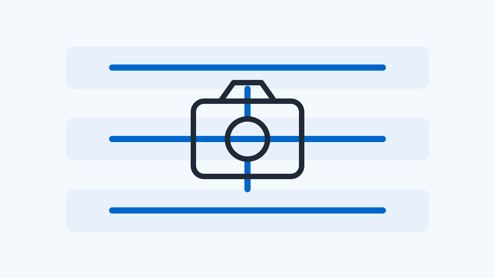

# 2026 W46 (11.09 ~ 11.15)

## 1. 이번 주 핵심

이번 호는 Galaxy A54 5G에서 세션을 멈출 때 생기는 SIGSEGV를 피하는 abortCaptures 우회 쿼크로 시작합니다. 이어서 CameraX가 세션을 다시 열지 않고 반복 요청만 바꾸는 빠른 세션 전환 1단계를 다룹니다. Camera2-pipe에서는 FrameGraph가 태그를 비교해 프레임을 버퍼에 나눠 담도록 바뀐 점과, CameraMetadata에 3A 모드와 플래시 지원 여부를 조회하는 확장 함수가 추가된 점을 살펴봅니다. 마지막으로 PreviewView PERFORMANCE 모드에서 CameraEffect를 쓸 때 생기던 회전 왜곡 수정을 소개합니다. 모두 AndroidX 소스에 병합된 변경이며, 공식 릴리스와 제품 반영 여부는 각 기사에서 확인된 범위를 밝혔습니다.

- [Galaxy A54 5G 세션 중지 시 Camera HAL SIGSEGV 방지를 위한 abortCaptures 우회 쿼크 병합](#article-galaxy-a54-5g-camera-hal-sigsegv-abortcaptures)

  Galaxy A54 5G의 SoC 드라이버와 HAL을 맡은 팀이 확인할 소식입니다. 이번 패치는 상위 프레임워크가 abortCaptures 호출을 피하게 할 뿐입니다. 크래시가 난 WNC-LmeMcscRepr 루틴에 널 포인터 참조나 메모리 해제 후 참조가 없는지는 하위 스택에서 따로 점검해야 합니다.

- [Camera2-pipe CameraMetadata에 3A 모드 및 플래시 지원 여부 조회 확장 함수 추가](#article-camera2-pipe-camerametadata-3a)

  센서 드라이버와 HAL 개발팀이 브링업할 때 참고할 소식입니다. Camera2-pipe 상위 계층이 정적 3A·플래시 지원 배열을 쉽게 질의하도록 감쌌으므로, 지원하는 AE, AF, AWB 모드 배열이 정적 메타데이터에 빠짐없이 채워져 있는지 확인하세요.

- [CameraX SessionConfig 빠른 세션 전환 1단계: 세션 재구성 없는 UseCase 서브셋 동적 전환 병합](#article-camerax-sessionconfig-1-usecase)

  CameraX는 세션을 재구성하지 않고 반복 요청만 갱신해 UseCase를 바꾸는 경로를 만들고 있습니다. HAL에서는 configureStreams를 다시 호출하는 빈도가 줄어들 수 있습니다. 대신 한 세션 안에서 스트림 대상이 바뀌는 반복 요청을 매끄럽게 처리하는 파이프라인 안정성이 더 중요해집니다.

- [Camera2-pipe FrameGraph 버퍼 프레임 필터링 개편: TagBundle 기반 정밀 라우팅 지원](#article-camera2-pipe-framegraph-tagbundle)

  HAL이 같은 스트림으로 내보낸 버퍼가 상위 FrameGraph에서 엉뚱한 버퍼로 들어가 낭비되지 않도록 정리되었습니다. HAL 엔지니어는 한 스트림을 여러 버퍼 소비자가 공유하는 시나리오에서 프레임워크 요청 메타데이터가 빠짐없이 결과로 돌아오는지 확인하세요.

- [PreviewView PERFORMANCE 모드 회전 왜곡 수정: CameraEffect 적용 시 SurfaceControl 및 TextureView 폴백](#article-previewview-performance-cameraeffect-surfacecontrol-textureview)

  드라이버와 HAL이 내보낸 버퍼가 프레임워크 중간 처리를 거치며 변환 메타데이터를 잃을 때 상위 뷰에서 생긴 결함을 고친 사례입니다. HAL 개발자는 버퍼 플래그와 변환 메타데이터가 프레임워크 소비자 계층까지 일관되게 전달되는지 점검하세요.

## 2. Galaxy A54 5G 세션 중지 시 Camera HAL SIGSEGV 방지를 위한 abortCaptures 우회 쿼크 병합

_AndroidX Gerrit Camera (change 4430441)_

Galaxy A54 5G에서 세션을 멈출 때 abortCaptures를 호출하지 않도록 하는 쿼크가 AndroidX 메인 브랜치에 병합되었습니다. 이 기기에서 카메라를 빠르게 전환하거나 종료하면 드라이버 프로세스가 비정상 종료되는 문제를 피하기 위한 우회책입니다.

### Camera HAL/Driver 관점에서의 의미

Galaxy A54 5G의 SoC 드라이버와 HAL을 맡은 팀이 확인할 소식입니다. 이번 패치는 상위 프레임워크가 abortCaptures 호출을 피하게 할 뿐입니다. 크래시가 난 WNC-LmeMcscRepr 루틴에 널 포인터 참조나 메모리 해제 후 참조가 없는지는 하위 스택에서 따로 점검해야 합니다.

카메라 앱이 화면을 닫거나 다른 카메라로 빠르게 전환하면 프레임워크가 세션을 정리합니다. 이 과정에서 프로세스 전체가 갑자기 중단되는 현상이 보고되었습니다.

커밋 메시지와 코드에 따르면 대상은 Samsung Galaxy A54 5G입니다. Exynos s5e8835 칩셋을 쓰며 디바이스 식별자는 a54x, 모델 접두사는 SM-A546입니다. 이 기기에서 캡처 세션을 멈출 때 CameraCaptureSession.abortCaptures를 호출하면 간헐적으로 네이티브 SIGSEGV 오류가 났습니다. 오류는 벤더 카메라 라이브러리 camera.s5e8835.so 안의 WNC-LmeMcscRepr 루틴에서 발생했고, 그 결과 카메라 프로바이더 프로세스가 완전히 종료되었습니다.

### 어떤 기기에서 우회하나요?

AndroidX 팀은 DisableAbortCapturesOnStopQuirk 클래스에 Galaxy A54 5G 판별 조건을 추가했습니다. 제조사가 Samsung이고 디바이스명이 a54x이거나 모델명이 SM-A546으로 시작하면 이 쿼크가 켜집니다. 쿼크가 켜지면 CameraPipe 그래프 설정에서 세션을 멈출 때 abortCaptures를 호출하지 않도록 플래그를 내립니다.

원문에서 확인된 적용 범위는 Tecno 일부 기기, Galaxy Note 10+, Poco X3 Pro에 이어 Galaxy A54 5G의 세부 변종까지입니다. 세부 변종에는 SM-A546E, SM-A546U1, SC-53D, a54xnsxx 등이 있습니다. 같은 제조사의 A53, A55, S24 계열은 이 쿼크의 대상에 포함되지 않습니다.

### 무엇을 확인하면 되나요?

해당 기기에서 카메라를 반복해서 시작하고 종료하거나 전면과 후면 카메라를 빠르게 번갈아 전환해 보세요. camera provider 프로세스의 크래시 로그(SIGSEGV in camera.s5e8835.so)가 사라지는지 관찰할 수 있습니다.

다만 이 패치는 상위 프레임워크에서 호출을 피하는 우회책입니다. 벤더 HAL 라이브러리 내부 메모리 오류의 근본 원인을 고친 것은 아닙니다.

### 지금 제품에 반영되었나요?

확인된 상태는 2026년 11월 12일 androidx-main 소스 트리에 커밋이 병합된 것까지입니다. CameraX 공식 배포 버전에 들어갔는지, 기기 펌웨어 업데이트가 적용되었는지는 별도로 추적해야 합니다.

[이번 주 핵심으로](#issue-briefing)

**출처**

- [Disable abortCaptures on stop for Galaxy A54 5G - platform/frameworks/support](https://android-review.googlesource.com/c/platform/frameworks/support/+/4430441)

---

## 3. Camera2-pipe CameraMetadata에 3A 모드 및 플래시 지원 여부 조회 확장 함수 추가

_AndroidX Gerrit Camera (Change 4439489)_

Camera2-pipe의 CameraMetadata에 3A 모드와 플래시 지원 여부를 조회하는 확장 함수가 추가되었습니다. 코드가 요청을 만들기 전에 정적 메타데이터 배열을 읽어 장치가 해당 설정을 지원하는지 간단히 확인할 수 있습니다.

### Camera HAL/Driver 관점에서의 의미

센서 드라이버와 HAL 개발팀이 브링업할 때 참고할 소식입니다. Camera2-pipe 상위 계층이 정적 3A·플래시 지원 배열을 쉽게 질의하도록 감쌌으므로, 지원하는 AE, AF, AWB 모드 배열이 정적 메타데이터에 빠짐없이 채워져 있는지 확인하세요.

카메라 요청을 만들 때 장치가 지원하지 않는 3A 모드를 지정하면 예상치 못한 동작이 나타날 수 있습니다. 그래서 요청 전에 가용성을 조회하는 작업이 필요합니다.

AndroidX 패치 4439489는 CameraMetadata 클래스에 3A 모드 가용성을 조회하는 isSupported 확장 함수들을 추가했습니다. 이 함수들은 CameraCharacteristics의 CONTROL_AE_AVAILABLE_MODES, CONTROL_AF_AVAILABLE_MODES, CONTROL_AWB_AVAILABLE_MODES, CONTROL_AVAILABLE_MODES 정적 키를 읽습니다. 인자로 받은 모드 값이 그 정수 배열에 들어 있으면 참을, 없으면 거짓을 반환합니다.

### 플래시 모드는 어떻게 판정하나요?

플래시 모드에는 별도 규칙이 적용됩니다. FlashMode.OFF는 장치 사양과 상관없이 항상 지원되는 것으로 판정됩니다. FlashMode.SINGLE과 FlashMode.TORCH는 hasFlashUnit 속성이 참일 때만 참을 반환합니다. hasFlashUnit은 정적 메타데이터의 FLASH_INFO_AVAILABLE을 기반으로 구성됩니다. 비표준 모드는 거짓을 반환합니다.

이 변경은 조회용 헬퍼 함수를 추가한 것입니다. 캡처 요청 파이프라인이 지원되지 않는 모드를 강제로 검증하거나 요청 전송을 막는 로직은 들어 있지 않습니다. 호출자가 요청을 만들기 전에 하드웨어 지원 여부를 물어볼 수 있게 한 편의 인터페이스입니다.

### 어떻게 확인하고, 어디까지 반영되었나요?

이 유틸리티는 단위 테스트 수준에서 점검할 수 있습니다. 특정 모드가 들어 있는 CameraMetadata 인스턴스에 AeMode.ON 또는 FlashMode.SINGLE을 전달해 기대한 boolean 결과가 나오는지 확인하면 됩니다. 이 확인은 조회 함수의 반환값만 보여 주며, 실제 드라이버 캡처 요청이 성공하는지는 보장하지 않습니다.

이 변경은 2026년 11월 13일 androidx-main 소스 브랜치에 병합된 상태입니다. 공식 AndroidX 라이브러리 배포나 상용 단말 빌드에 포함되었는지는 확인되지 않았습니다.

[이번 주 핵심으로](#issue-briefing)

**출처**

- [Add 3A mode isSupported functions to CameraMetadata - platform/frameworks/support](https://android-review.googlesource.com/c/platform/frameworks/support/+/4439489)

---

## 4. CameraX SessionConfig 빠른 세션 전환 1단계: 세션 재구성 없는 UseCase 서브셋 동적 전환 병합

_AndroidX Gerrit Camera (Change 4381870)_

CameraX에 세션을 다시 열지 않고 사용 사례만 바꾸는 빠른 세션 전환의 1단계가 병합되었습니다. 사용 사례를 바꿀 때마다 세션을 새로 열면서 생기던 화면 깜빡임과 지연을 줄이려는 변경입니다.

### Camera HAL/Driver 관점에서의 의미

CameraX는 세션을 재구성하지 않고 반복 요청만 갱신해 UseCase를 바꾸는 경로를 만들고 있습니다. HAL에서는 configureStreams를 다시 호출하는 빈도가 줄어들 수 있습니다. 대신 한 세션 안에서 스트림 대상이 바뀌는 반복 요청을 매끄럽게 처리하는 파이프라인 안정성이 더 중요해집니다.

미리보기 중에 비디오 녹화나 이미지 캡처 같은 사용 사례를 더하거나 빼면 세션을 완전히 다시 구성해야 합니다. 이때 상당한 시간 지연이 생깁니다.

AndroidX 패치 4381870은 바인딩된 UseCase 가운데 실제로 동작할 활성 하위 집합을 세션 재생성 없이 바꾸는 1단계 구조를 도입했습니다. SessionConfig.Builder에 추가된 initialEnabledUseCases 메서드는 처음에 활성화할 UseCase 목록을 순서를 유지하고 중복 없이 구성합니다. 함께 도입된 CameraControl.setEnabledUseCasesAsync 함수는 실행 중인 CameraCaptureSession을 닫지 않고 반복 요청의 대상 출력 서브셋만 갱신합니다.

### 전환은 언제 끝나고 어떻게 검증하나요?

이 비동기 전환 호출은 갱신된 UseCase 집합이 반영된 반복 요청의 첫 번째 캡처 결과가 도착할 때 완료됩니다. 프레임워크 내부의 검사기들은 고속 촬영, 확장 기능, 동시 카메라, 제로 셔터 랙, 여러 하드웨어 쿼크와의 호환성을 사전에 확인합니다.

비활성화된 서브셋에 반복 스트림이 없을 경우를 대비한 안전장치도 포함되었습니다. 이 장치는 측광용 반복 스트림을 자동으로 미리 연결합니다.

이 변경은 1단계이며 라이브러리 내부 전용으로 제한되어 있습니다. Camera HAL의 configureStreams 계약을 바꾼 것이 아니라 프레임워크 상위의 세션 운용 방식을 최적화한 것입니다.

### 무엇을 확인하면 되나요?

이 기능이 동작할 때 상위 세션이 닫히지 않고 setRepeatingBurst 또는 setRepeatingRequest만 다시 호출되는지 관찰해 볼 수 있습니다. 이는 커밋 내용에 기반한 확인 제안이며, 실제 단말에서 측정한 결과는 확인되지 않았습니다.

소스는 2026년 11월 9일 androidx-main 브랜치에 병합되었습니다. 공식 AndroidX 릴리스나 상용 단말 펌웨어 빌드에 반영되었는지는 별도로 확인해야 합니다.

[이번 주 핵심으로](#issue-briefing)

**출처**

- [Add SessionConfig fast session switch Phase 1 - platform/frameworks/support](https://android-review.googlesource.com/c/platform/frameworks/support/+/4381870)

---

## 5. Camera2-pipe FrameGraph 버퍼 프레임 필터링 개편: TagBundle 기반 정밀 라우팅 지원

_AndroidX Gerrit Camera (Change 4371710)_

Camera2-pipe의 FrameGraph가 요청 파라미터와 태그를 비교해 프레임을 버퍼에 넣도록 바뀌었습니다. 여러 버퍼가 같은 스트림을 공유할 때 의도하지 않은 프레임이 들어와 기존 버퍼 데이터가 밀려나던 문제를 고치기 위한 변경입니다.

### Camera HAL/Driver 관점에서의 의미

HAL이 같은 스트림으로 내보낸 버퍼가 상위 FrameGraph에서 엉뚱한 버퍼로 들어가 낭비되지 않도록 정리되었습니다. HAL 엔지니어는 한 스트림을 여러 버퍼 소비자가 공유하는 시나리오에서 프레임워크 요청 메타데이터가 빠짐없이 결과로 돌아오는지 확인하세요.

여러 버퍼가 같은 카메라 스트림을 참조하는 경우를 생각해 봅시다. 다른 설정으로 요청한 프레임이 원하지 않는 버퍼에 들어가면 버퍼가 일찍 가득 차고 프레임이 손실될 수 있습니다.

이전 구조에서는 FrameGraph가 시작된 모든 프레임을 연결된 모든 FrameBuffer에 그대로 전달했습니다. 그래서 단발성 캡처나 개별 설정을 가진 프레임이 다른 버퍼에 들어가 기존 프레임을 덮어쓰고 밀어내는 부작용이 있었습니다.

### TagBundle은 무엇이고 어떤 조건에서 프레임을 받나요?

AndroidX 패치 4371710은 프레임의 Request가 버퍼에 지정된 파라미터와 태그에 일치할 때만 프레임을 버퍼에 추가하도록 검사 로직을 바꿨습니다. 새로 추가된 TagBundle은 변경할 수 없는 태그 집합입니다. Metadata.Key의 타입으로 지정되어 프레임 소비자를 식별합니다. Request.extras에 든 TagBundle이 버퍼의 모든 태그를 포함해야 프레임이 수신됩니다.

일반 CaptureRequest.Key 파라미터도 비슷합니다. 요청에 담긴 값이 버퍼에 바인딩된 값과 같아야 프레임이 들어옵니다.

FrameGraph가 만드는 반복 요청은 연결된 모든 버퍼의 파라미터와 TagBundle의 합집합을 포함합니다. 그래서 정상 실행 중인 반복 프레임은 조건을 충족하는 모든 버퍼에 안정적으로 도달합니다.

### 어떻게 확인하고, 반영 상태는 어떤가요?

같은 스트림에 서로 다른 TagBundle을 지정한 버퍼 두 개를 연결하고, 특정 태그를 가진 단발 캡처를 요청해 보세요. 해당 태그를 가진 버퍼에만 프레임이 들어가고 다른 버퍼의 큐 크기는 변하지 않는지 단위 테스트나 통합 테스트로 확인할 수 있습니다. 이는 커밋 diff에 적힌 동작 원리에 따른 점검 제안입니다.

이 변경은 2026년 11월 13일 androidx-main 브랜치에 병합되었습니다. 최종 라이브러리 릴리스나 제품 펌웨어 빌드에 반영되었는지는 확인되지 않았습니다.

[이번 주 핵심으로](#issue-briefing)

**출처**

- [Filter FrameGraph buffer frames by parameters - platform/frameworks/support](https://android-review.googlesource.com/c/platform/frameworks/support/+/4371710)

---

## 6. PreviewView PERFORMANCE 모드 회전 왜곡 수정: CameraEffect 적용 시 SurfaceControl 및 TextureView 폴백

_AndroidX Gerrit Camera (Change 4418107)_

PreviewView의 PERFORMANCE 모드에서 CameraEffect나 스트림 공유를 켜면 화면이 늘어나거나 옆으로 누워 보이던 현상이 수정되었습니다. 시스템 버전에 맞춰 회전을 보정하는 렌더링 계층이 PreviewView에 추가되었습니다.

### Camera HAL/Driver 관점에서의 의미

드라이버와 HAL이 내보낸 버퍼가 프레임워크 중간 처리를 거치며 변환 메타데이터를 잃을 때 상위 뷰에서 생긴 결함을 고친 사례입니다. HAL 개발자는 버퍼 플래그와 변환 메타데이터가 프레임워크 소비자 계층까지 일관되게 전달되는지 점검하세요.

PERFORMANCE 모드는 고성능 미리보기를 위해 SurfaceView를 씁니다. 이 모드에서 그래픽 효과나 스트림 공유를 적용하면 화면 방향이 어긋나는 경우가 있었습니다.

### 왜 화면이 늘어나거나 누웠나요?

SurfaceView는 기본적으로 버퍼에 담긴 카메라 변환 메타데이터만 화면에 반영합니다. 그런데 CameraEffect나 스트림 공유 파이프라인을 거친 스트림은 카메라 하드웨어 변환 정보가 버퍼에서 사라지거나 바뀔 수 있습니다. 그러면 남은 회전 각도가 제대로 적용되지 않습니다. 그 결과 미리보기가 옆으로 돌아가거나 가로세로 비율이 늘어났습니다.

### 시스템 버전에 따라 어떻게 다르게 처리하나요?

AndroidX 패치 4418107은 스트림에서 카메라 변환이 빠졌는지 판단하고, API 레벨에 따라 렌더링 방식을 나눴습니다. API 29 이상에서는 SurfaceView 아래에 중간 SurfaceControl 계층을 만들어 남은 회전 각도만큼 지오메트리를 돌립니다. API 31 이상에서는 이 회전이 View 변환과 동기화되어 다음 프레임이 그려질 때 바로 반영됩니다.

SurfaceControl로 세부 제어하기 어려운 API 29 미만의 구형 기기에서는 이런 스트림에 TextureView를 사용합니다. 이 결정은 스트림의 카메라 변환 유무에 따라 처음에 한 번 정해집니다. 그래서 이후 단순한 화면 회전이 일어나도 서피스를 불필요하게 없애고 다시 만들지 않습니다.

### 어떻게 확인하고, 반영 상태는 어떤가요?

CameraEffect를 적용한 상태에서 Preview.setTargetRotation을 호출하고 단말 화면을 돌려 보세요. 서피스를 다시 만들지 않으면서 미리보기에 왜곡이나 회전 오류가 없는지 뷰 테스트 환경에서 검증할 수 있습니다. 이는 커밋 메시지에 적힌 동작 원리에 기초한 확인 제안입니다.

이 수정은 2026년 11월 10일 androidx-main 브랜치에 머지되었습니다. 라이브러리 릴리스와 실제 제품 펌웨어에 반영되었는지는 별도로 확인해야 합니다.

[이번 주 핵심으로](#issue-briefing)

**출처**

- [Fix PreviewView PERFORMANCE rotation with effects - platform/frameworks/support](https://android-review.googlesource.com/c/platform/frameworks/support/+/4418107)

## 참고 / 더 읽을거리

- [Sync PreviewView with display rotation - platform/frameworks/support](<https://android-review.googlesource.com/c/platform/frameworks/support/+/4433911>) — AndroidX Gerrit Camera (2026-11-12) · AOSP Camera 프레임워크 관련 참고
- [How SmileID Scaled Identity Verification to 18,000+ Android Device Types with CameraX](<https://developer.android.com/blog/posts/smileid-camerax-android-identity-verification>) — Android Developers Blog (2026-11-11) · AOSP Camera 프레임워크 관련 참고
- [Report HLG10 + stab + UHD unsupported on S26 - platform/frameworks/support](<https://android-review.googlesource.com/c/platform/frameworks/support/+/4425978>) — AndroidX Gerrit Camera (2026-11-10) · AOSP Camera 프레임워크 관련 참고
- [Force StreamSharing for HLG10 + stab on SM8550 - platform/frameworks/support](<https://android-review.googlesource.com/c/platform/frameworks/support/+/4426038>) — AndroidX Gerrit Camera (2026-11-09) · AOSP Camera 프레임워크 관련 참고

## 참고자료

- [Disable abortCaptures on stop for Galaxy A54 5G - platform/frameworks/support](https://android-review.googlesource.com/c/platform/frameworks/support/+/4430441)
- [Add 3A mode isSupported functions to CameraMetadata - platform/frameworks/support](https://android-review.googlesource.com/c/platform/frameworks/support/+/4439489)
- [Add SessionConfig fast session switch Phase 1 - platform/frameworks/support](https://android-review.googlesource.com/c/platform/frameworks/support/+/4381870)
- [Filter FrameGraph buffer frames by parameters - platform/frameworks/support](https://android-review.googlesource.com/c/platform/frameworks/support/+/4371710)
- [Fix PreviewView PERFORMANCE rotation with effects - platform/frameworks/support](https://android-review.googlesource.com/c/platform/frameworks/support/+/4418107)
