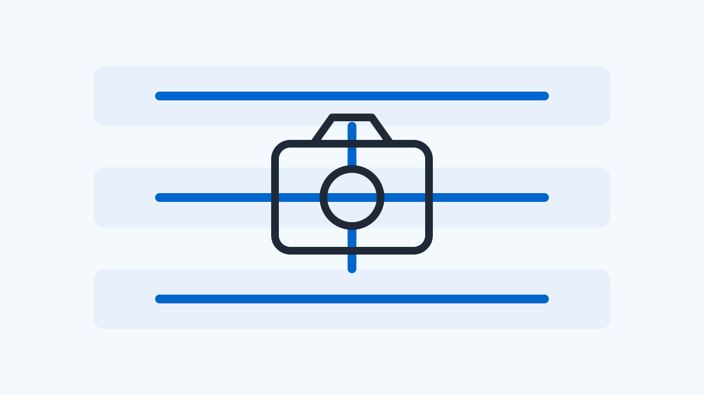

# 2026 W47 (11.16 ~ 11.22)

## 1. 이번 주 핵심

이번 주 뉴스레터에서는 CameraX 1.7.0 릴리스와 Camera2 Pipe 3A 제어 변경 등 상위 프레임워크의 중요한 업데이트를 다룹니다. 특히 CameraX 1.7.0은 Camera2Interop V2를 안정화하여 물리 카메라 직접 바인딩을 지원합니다. 삼성 SM-F971 단말의 ZSL 비활성화와 오포 Find N3 Flip의 물리 카메라 노출 제외 사례는 특정 기기에서 발생하는 HAL 및 드라이버 수준의 문제를 보여줍니다. 또한, 비디오 녹화 시작 전 프레임 충돌 방지를 위한 인코더 입력 서피스 일시 중단 처리 소식도 함께 전해드립니다.

- [CameraX 1.7.0 릴리스: Camera2Interop V2 안정화와 물리 카메라 직접 바인딩](#article-camerax-1-7-0-camera2interop-v2)

  HAL 직접 변경은 아니지만, 상위 프레임워크가 논리 카메라 하위의 물리 스트림에 UseCase를 직접 연결하기 시작합니다. 벤더 파이프라인에서 물리 카메라별 OutputConfiguration 구성과 메타데이터 반환 누락이 없는지 사전 점검이 필요합니다.

- [Camera2 Pipe 3A 제어 변경: 지원되지 않는 모드는 요청 즉시 SUBMIT_FAILED 반환](#article-camera2-pipe-3a-submit-failed)

  HAL이나 드라이버 자체의 계약 변경은 아니지만, 상위 프레임워크가 CameraMetadata에 선언된 3A capabilities를 엄격히 대조하기 시작합니다. CameraCharacteristics에 지원 모드를 잘못 선언하면 상위 앱에서 3A 제어가 즉시 실패하므로 벤더 태그 및 정적 메타데이터 정합성을 검증해야 합니다.

- [삼성 SM-F971 ZSL 비활성화: 물리 렌즈 줌 전환 중 멈춤 방지](#article-sm-f971-zsl)

  벤더 HAL 내부의 재처리 스트림과 멀티 카메라 SAT 전환 로직 간 충돌 사례입니다. 재처리 세션에서 물리 렌즈 전환 시 벤더 HAL이 프레임 결과 콜백을 누락하거나 플러시 중 멈추지 않도록 HAL 드라이버 버퍼 관리를 점검해야 합니다.

- [오포 Find N3 Flip 물리 카메라 노출 제외: 특정 렌즈 타깃 시 멈춤 해결](#article-find-n3-flip)

  논리 카메라 하위의 특정 물리 센서 스트림을 구성할 때 벤더 HAL의 스트리밍 노드 및 세션 플러시 로직이 교착 상태에 빠질 수 있음을 보여줍니다. 벤더 HAL 개발팀은 물리 스트림 분기 시 세션 종료 시퀀스와 워치독 타임아웃 발생 지점을 정밀 검토해야 합니다.

- [비디오 녹화 시작 전 프레임 충돌 방지: 인코더 입력 서피스 일시 중단 처리](#article-vwb7ok)

  Camera HAL 자체의 인터페이스 변경은 아니지만, 카메라 프레임 버퍼가 Surface를 통해 비디오 인코더로 전달되는 다운스트림 경로의 중요한 동기화 개선입니다. 카메라 파이프라인에서 인코더 서피스로 프레임을 밀어 넣을 때 코덱 시작 전 드롭 동작이 미치는 영향을 이해하는 데 유용합니다.

## 2. CameraX 1.7.0 릴리스: Camera2Interop V2 안정화와 물리 카메라 직접 바인딩

_Android Developers Latest Updates_

CameraX 1.7.0이 정식 출시되며 Camera2Interop V2가 기본 안정화 단계로 전환되었습니다. 이제 개발자는 추가 옵트인 없이 상위 앱 인터페이스에서 물리 카메라를 직접 선택하고 바인딩할 수 있습니다.

### Camera HAL/Driver 관점에서의 의미

HAL 직접 변경은 아니지만, 상위 프레임워크가 논리 카메라 하위의 물리 스트림에 UseCase를 직접 연결하기 시작합니다. 벤더 파이프라인에서 물리 카메라별 OutputConfiguration 구성과 메타데이터 반환 누락이 없는지 사전 점검이 필요합니다.

_이미지: [CameraX Release Notes - CameraX 1.7.0](https://developer.android.com/jetpack/androidx/releases/camera#1.7.0)_

구글이 2026년 11월 18일 배포한 CameraX 1.7.0 릴리스는 상위 프레임워크와 하위 Camera2 사이의 상호 운용성을 크게 손질했습니다. 이번 판에서는 이전 실험 단계에 머물렀던 Camera2Interop V2가 안정화되어 별도 opt-in 없이 기본 제공됩니다.

재설계된 인터페이스는 ImageWrapper와 non-nullable ByteBuffer를 갖는 ImagePlane을 도입했습니다. ImageProxy와 ImageProxy.PlaneProxy가 이 래퍼 규격을 구현하며, FakeImage나 FakeCameraCharacteristics 같은 테스트용 객체도 함께 제공됩니다.

멀티 카메라 제어 경로에도 큰 변화가 적용되었습니다. 개발자는 CameraInfo.getPhysicalCameraInfos 호출로 물리 카메라 전용 CameraSelector를 얻고, 개별 UseCase를 특정 물리 센서에 직접 바인딩할 수 있습니다. 해당 Selector로 getCameraInfo를 조회하면 논리 카메라 대신 실제 물리 카메라 정보가 반환됩니다.

3A 제어 측면에서는 FocusMeteringAction에 잠금 모드가 추가되었습니다. FLAG_AE와 FLAG_AWB를 잠그거나 연속 자동 초점 모드를 유지한 채 측정 영역만 갱신하는 FLAG_AF 동작을 구분해 지정할 수 있습니다. 또한 저조도 환경을 판별하는 NightModeIndicator와 토치 및 저조도 부스트 간 충돌 방지 로직도 공식 포함되었습니다.

이 변경은 Jetpack CameraX 라이브러리의 프레임워크 계층 동작입니다. 하위 Camera HAL3 인터페이스 규격 자체가 바뀐 것은 아니지만, 앱이 요청하는 물리 스트림 분기나 3A 메타데이터 조합이 실제 벤더 HAL로 직결되므로 상호 작용을 주의 깊게 살펴야 합니다.

[이번 주 핵심으로](#issue-briefing)

**출처**

- [CameraX Release Notes - CameraX 1.7.0](https://developer.android.com/jetpack/androidx/releases/camera#1.7.0)

---

## 3. Camera2 Pipe 3A 제어 변경: 지원되지 않는 모드는 요청 즉시 SUBMIT_FAILED 반환

_AndroidX Gerrit Camera_

카메라 앱이 기기에서 지원하지 않는 자동 노출이나 초점 모드를 요청하면 내부 큐에 머물지 않고 즉시 실패를 반환합니다. AndroidX Camera2 Pipe 라이브러리는 하위 스택에 불필요한 요청이 도달하기 전에 차단하는 검증 분기를 병합했습니다.

### Camera HAL/Driver 관점에서의 의미

HAL이나 드라이버 자체의 계약 변경은 아니지만, 상위 프레임워크가 CameraMetadata에 선언된 3A capabilities를 엄격히 대조하기 시작합니다. CameraCharacteristics에 지원 모드를 잘못 선언하면 상위 앱에서 3A 제어가 즉시 실패하므로 벤더 태그 및 정적 메타데이터 정합성을 검증해야 합니다.

카메라 앱이 벤더 하드웨어가 지원하지 않는 3A 모드를 요청하면 파이프라인 내부에서 지연이나 예측 불가능한 거동이 발생할 수 있습니다. 2026년 11월 19일 AndroidX androidx-main 브랜치에 병합된 변경(Change 4439488)은 이러한 잘못된 요청을 진입 단계에서 걸러냅니다.

수정 전에는 지원되지 않는 모드가 들어와도 반복 요청 큐나 하위 프레임워크로 전달될 위험이 있었습니다. 이번 패치는 Controller3A의 lock3A, submit3A, update3A 메서드 시작부에 areModesSupported 검사를 추가했습니다. 요청된 AE, AF, AWB, Flash, Control 모드가 CameraMetadata의 지원 목록에 없으면 즉시 SUBMIT_FAILED 결과를 반환합니다.

이때 기존의 3A 상태는 변경되지 않고 그대로 유지됩니다. 또한 검사 함수는 미지원 항목마다 경고 로그를 남겨 디버깅 시 어떤 모드가 기기 스펙과 어긋났는지 바로 확인할 수 있게 했습니다.

### 현장 진단과 확인 방법

만약 특정 기기에서 3A 잠금이나 파라미터 갱신이 실패한다면 먼저 logcat에서 Log.TAG로 필터링해 경고 메시지를 확인하는 것이 좋습니다. Unsupported aeMode 또는 Unsupported afMode 로그가 찍힌다면 앱이 CameraCharacteristics의 지원 목록을 벗어난 요청을 보낸 것입니다.

이 변경은 현재 AndroidX 소스 트리에 병합된 상태입니다. 실제 라이브러리 공식 릴리스 아티팩트 배포나 개별 제품 단말 빌드 탑재는 별도 배포 과정을 거쳐야 확인할 수 있습니다.

[이번 주 핵심으로](#issue-briefing)

**출처**

- [Check if 3A modes are supported in Controller3A - platform/frameworks/support](https://android-review.googlesource.com/c/platform/frameworks/support/+/4439488)

---

## 4. 삼성 SM-F971 ZSL 비활성화: 물리 렌즈 줌 전환 중 멈춤 방지

_AndroidX Gerrit Camera_

삼성 SM-F971 단말에서 카메라 줌을 넘나들 때 화면이 멈추는 현상을 막기 위해 제로 셔터 랙 기능이 비활성화되었습니다. 재처리 세션에서 벤더 파이프라인 콜백이 끊기던 문제를 우회 조치한 것입니다.

### Camera HAL/Driver 관점에서의 의미

벤더 HAL 내부의 재처리 스트림과 멀티 카메라 SAT 전환 로직 간 충돌 사례입니다. 재처리 세션에서 물리 렌즈 전환 시 벤더 HAL이 프레임 결과 콜백을 누락하거나 플러시 중 멈추지 않도록 HAL 드라이버 버퍼 관리를 점검해야 합니다.

여러 물리 렌즈를 전환하며 사진을 찍을 때 재처리 버퍼 관리가 어긋나면 파이프라인 전체가 정지될 수 있습니다. 2026년 11월 17일 병합된 AndroidX 변경(Change 4441195)은 삼성 SM-F971U1 단말에서 발견된 줌 전환 멈춤 현상을 다룹니다.

해당 단말은 PRIVATE 재처리 ZSL 세션으로 구성된 상태에서 물리 렌즈 간 줌 비율을 전환하면 CamX SAT 파이프라인이 정지했습니다. 예컨대 0.6배 광각에서 2.0배 망원으로 넘어갈 때 새로운 반복 요청에 대한 TotalCaptureResult가 전달되지 않아 setZoomRatio 비동기 작업이 타임아웃되었습니다.

원문 커밋에 따르면 일반 비-ZSL 세션에서는 모든 줌 전환과 촬영이 지연 없이 정상 동작했습니다. 이에 따라 개발팀은 ZslDisablerQuirk의 대상 목록에 SM-F971 모델 접두사를 추가했습니다. 이제 해당 단말의 ImageCapture는 ZSL 대신 표준 스틸 캡처 방식으로 전환됩니다.

### 현장 진단과 반영 한계

특정 단말에서 줌 조절 시 화면 갱신이 멈추고 타임아웃이 발생한다면 기존 로그에서 TotalCaptureResult 전달 여부와 ZSL 활성화 상태를 확인해 원인을 가를 수 있습니다. 일반 캡처 모드로 강제했을 때 정지가 사라진다면 ZSL 재처리 파이프라인 충돌일 가능성이 높습니다. 우회 조치 적용 여부는 CameraInfo.isZslSupported 반환값이 false인지 조회하여 확인할 수 있습니다.

이 패치는 AndroidX Gerrit에 병합된 소스 코드 수정입니다. 라이브러리 정식 릴리스 및 실제 기기 상용 펌웨어 빌드 반영 여부는 별도로 확인해야 합니다.

[이번 주 핵심으로](#issue-briefing)

**출처**

- [Disable ZSL on Samsung SM-F971 - platform/frameworks/support](https://android-review.googlesource.com/c/platform/frameworks/support/+/4441195)

---

## 5. 오포 Find N3 Flip 물리 카메라 노출 제외: 특정 렌즈 타깃 시 멈춤 해결

_AndroidX Gerrit Camera_

오포 Find N3 Flip 단말에서 특정 물리 카메라를 직접 지정해 스트림을 열면 카메라 서비스가 강제 종료되던 문제가 해결되었습니다. 라이브러리 차원에서 해당 물리 렌즈 ID를 노출 목록에서 제외하는 패치가 병합되었습니다.

### Camera HAL/Driver 관점에서의 의미

논리 카메라 하위의 특정 물리 센서 스트림을 구성할 때 벤더 HAL의 스트리밍 노드 및 세션 플러시 로직이 교착 상태에 빠질 수 있음을 보여줍니다. 벤더 HAL 개발팀은 물리 스트림 분기 시 세션 종료 시퀀스와 워치독 타임아웃 발생 지점을 정밀 검토해야 합니다.

멀티 카메라 기기에서 앱이 특정 보조 렌즈로 직접 스트림을 구성할 때 벤더 드라이버가 예상치 못한 교착 상태에 빠지는 사례가 있습니다. 2026년 11월 17일 병합된 AndroidX 변경(Change 4440995)은 오포 Find N3 Flip 단말의 안정성을 확보하기 위한 조치입니다.

미디어텍 mt6985 플랫폼을 사용하는 오포 PHT110 모델에서는 후면 논리 카메라(ID 0) 하위의 물리 카메라 ID 2번 또는 3번을 OutputConfiguration의 타깃으로 지정할 경우 문제가 생겼습니다. 벤더 HAL 내부의 P2StreamingNode 프레임 캡처 및 BasicSession 플러시 정리 단계에서 정지가 발생했습니다. 이로 인해 camerahalserver와 cameraserver 워치독이 동작하며 카메라 연결이 강제로 끊어지는 치명적 장애로 이어졌습니다.

개발팀은 ExcludePhysicalCameraIdQuirk의 문제 모델 목록에 PHT110과 제외 대상 ID인 2번, 3번을 추가했습니다. 패치 적용 후 CameraInfo.getPhysicalCameraInfos를 호출하면 해당 물리 카메라 정보가 목록에서 완전히 숨겨집니다.

### 현장 진단과 확인 방법

단말에서 물리 카메라 스트림을 열 때 ERROR_CAMERA_DEVICE나 CAMERA_DISCONNECTED가 발생한다면 로그캣에서 camerahalserver 워치독 로그와 BasicSession 플러시 타임아웃 기록을 대조해 원인을 확인할 수 있습니다. 우회 조치가 정상 적용되었는지는 CameraInfo.getPhysicalCameraInfos의 반환 목록에 물리 ID 2와 3이 빠져 있는지 확인하면 됩니다.

이 수정은 AndroidX Gerrit에 머지된 소스 코드 상태입니다. 기기 제조사의 공식 시스템 업데이트나 앱의 Jetpack 라이브러리 릴리스 빌드 반영 여부는 별도로 확인해야 합니다.

[이번 주 핵심으로](#issue-briefing)

**출처**

- [Exclude OPPO PHT110 physical camera IDs 2 and 3 - platform/frameworks/support](https://android-review.googlesource.com/c/platform/frameworks/support/+/4440995)

---

## 6. 비디오 녹화 시작 전 프레임 충돌 방지: 인코더 입력 서피스 일시 중단 처리

_AndroidX Gerrit Camera_

녹화 버튼을 누르기 직전 카메라 버퍼가 인코더에 먼저 전달되면 비디오 시작 시점에 오류가 생길 수 있습니다. AndroidX Video 라이브러리는 인코더 시작 전 들어오는 프레임을 안전하게 버리도록 동작을 바꿨습니다.

### Camera HAL/Driver 관점에서의 의미

Camera HAL 자체의 인터페이스 변경은 아니지만, 카메라 프레임 버퍼가 Surface를 통해 비디오 인코더로 전달되는 다운스트림 경로의 중요한 동기화 개선입니다. 카메라 파이프라인에서 인코더 서피스로 프레임을 밀어 넣을 때 코덱 시작 전 드롭 동작이 미치는 영향을 이해하는 데 유용합니다.

카메라 미리보기와 녹화 파이프라인이 동시에 구동될 때 인코더 시작과 프레임 전송 타이밍이 어긋나면 코덱 초기화 단계에서 문제가 생깁니다. 2026년 11월 20일 병합된 AndroidX 변경(Change 4400407)은 이 동기화 결함을 바로잡았습니다.

기존 EncoderImpl은 MediaCodec을 미리 구성하고 영구 입력 서피스를 연결해 둔 상태로 대기했습니다. 그러나 상위 Recorder는 오디오 장치를 초기화하고 start를 호출하기 전에 비디오 스트림을 먼저 활성 상태로 표시했습니다. 그 결과 코덱이 아직 구성 상태일 때 카메라에서 렌더링된 프레임이 GraphicBufferSource에 누적되었습니다.

이 프레임들은 MediaCodec.start 내부에서 즉시 제출되었고, CCodecBufferChannel이 출력 버퍼 풀 초기화를 미처 끝내기 전에 처리되면서 불안정한 상태를 초래했습니다.

해결을 위해 API 29 이상 환경에서 MediaFormat.KEY_CREATE_INPUT_SURFACE_SUSPENDED 플래그를 1로 지정했습니다. 코덱이 준비되는 동안 영구 입력 서피스는 들어오는 카메라 프레임을 자동으로 버립니다. 그리고 mMediaCodec.start 호출이 완료된 직후 일시 중단 상태를 해제하여 정상 인코딩을 시작합니다.

### 현장 진단과 확인 방법

비디오 녹화 진입 직후 인코더 오류나 첫 프레임 충돌이 의심된다면 첫 번째 인코딩 결과물의 presentationTimeUs를 확인하는 방법이 유효합니다. 녹화 시작 시점보다 앞선 타임스탬프의 프레임이 인코더에 인입되지 않고 시작 시점 이후의 키 프레임부터 정상 생성되는지 살펴보면 됩니다.

이 수정은 AndroidX Gerrit에 병합된 코드 변경입니다. 커밋에 언급된 연계 버그 내용은 직접 확인되지 않았으며, 실제 배포 라이브러리 탑재와 최종 단말 상용 빌드 반영 여부도 별도의 확인이 필요합니다.

[이번 주 핵심으로](#issue-briefing)

**출처**

- [Suspend video encoder input surface until start - platform/frameworks/support](https://android-review.googlesource.com/c/platform/frameworks/support/+/4400407)

## 참고자료

- [CameraX Release Notes - CameraX 1.7.0](https://developer.android.com/jetpack/androidx/releases/camera#1.7.0)
- [Check if 3A modes are supported in Controller3A - platform/frameworks/support](https://android-review.googlesource.com/c/platform/frameworks/support/+/4439488)
- [Disable ZSL on Samsung SM-F971 - platform/frameworks/support](https://android-review.googlesource.com/c/platform/frameworks/support/+/4441195)
- [Exclude OPPO PHT110 physical camera IDs 2 and 3 - platform/frameworks/support](https://android-review.googlesource.com/c/platform/frameworks/support/+/4440995)
- [Suspend video encoder input surface until start - platform/frameworks/support](https://android-review.googlesource.com/c/platform/frameworks/support/+/4400407)
